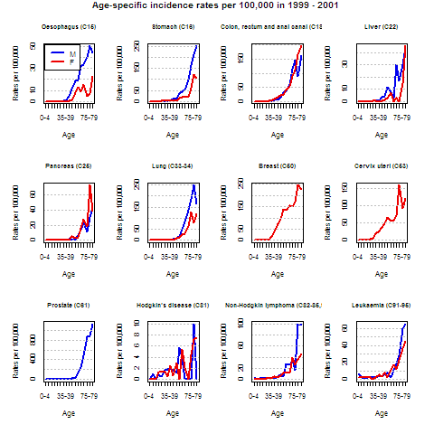
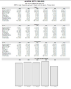

# CanReg Analysis and R

**Author:** Morten Johannes ERVIK, Freddie BRAY  
**Publisher:** International Agency for Research on Cancer (IARC / WHO)

---

## Introduction

CanReg5 is an open source tool to input, store, check and analyse cancer registry data. It has modules to do data entry, quality control, consistency checks and basic analysis of the data.

R is a powerful open source freely available software package that could be coupled with CanReg to improve the analytical capabilities.

## What data does registries store in CanReg5

### Data elements

Each case has (at least):

- Sex
- Incidence date
- Birth date (or age at the time of tumour)
- Coded address at the time of the tumour
- Topography, Morphology, Behaviour in ICD-O-3
- Most valid basis of diagnosis
- ICD-10 and ICCC
- Date of last contact
- Vital status
- Source info:
  - (Type of)
  - Number of
  - (Dates)

### Population data

Each registry also has population data sets (denominators).

## What we *do* with that data now

- Incidence tables (Per 100,000 per cancer group, age group, ASR, CR etc.)
- Number of cases (per cancer group, age group)
- Population pyramids
- Frequencies by year

Otherwise data needs to be exported to be analysed in other software packages.

## What we *could* do with that data

### Graphs

#### Bar charts by cancer/sex

- Incidence tables
- Number of cases

#### Time trends

- ASRs (world) over time
- Age specific rates over time
- Age specific rates over cohort

### Quality indicators

#### Validity

- DCO%
- PSU%
- MV%
- Compared with other registries (CI5 IX)
- DCO% over time
  - potentially with graphs

#### Completeness

- Reference childhood incidence comparison
- Stability of rates over time by cancer/sex
  - potentially with graphs
- Age specific rates by cancer/sex
- Sources
  - number of sources per case
  - number of notifications per case

### Geographic visualizations, maps?

- Complicated as this needs to be set up for each registry.

## What we could do if we linked it to other data

This is more for the future, but might be interesting...

- If linked to mortality data
  - M/I ratios as estimator of completeness

## Technical aspects

### Getting the data to R - and back

Basically two main ways to do it - using Java-R library calls or exporting data, but we decided on the most loosely coupled way.

#### Export the data from CanReg5 to files readable by R and then call R in batch mode

Preferred method - more dynamic and loosely coupled. Easier to potentially reuse R code later.

### Output file formats

Graphics should be output in a format that can be used by many. The user can choose from the following formats (Ref: <http://www.stat.auckland.ac.nz/~paul/R/devices.html>):

#### Portable Network Graphics - PNG

Very convenient for many things, but not scalable. R can export directly to this format.

#### Scalable Vector Graphics - SVG

Scalable, open standard. Allows for direct editing and manipulation in programs such as Adobe Illustrator or Inkscape. R can export directly to this format.

#### (Encapsulated) PostScript - (E)PS

Scalable, open standard, ready to print. Good for publications. R can export directly to this format.

#### Portable Document Format - PDF

Scalable, open standard, ready to print. R can export directly to this format.

#### Character Separated Values - CSV

It would be good to write the values used in any table to a CSV file as well for further use.

## What now

We want to prioritize things that can produce figures and/or look better in R than using Java.

### Priorities

1. Need to specify diagnostic groups. Dynamic? (User definable?)

  1. Need to specify diagnostic groups. Dynamic? (User definable?)
2. Quality indicators in major diagnostic groups (the last of the "not yet implemented")
  1. Need to specify diagnostic groups. Dynamic? (User definable?)
  2. Compared to another reference registry? In the region/world?
3. Time trends

### In the long(er) run

#### Templates for reports from registries

We can make these R scripts work together and build a multi-page report directly from CanReg5. To get there we first need to design what we would ideally want in this report and then implement the necessary parts in CanReg and R. One thing we most probably would want is a way for the user to enter some free text. These reports could be output as PDFs (ready to print) or HTML (ready for the web).

