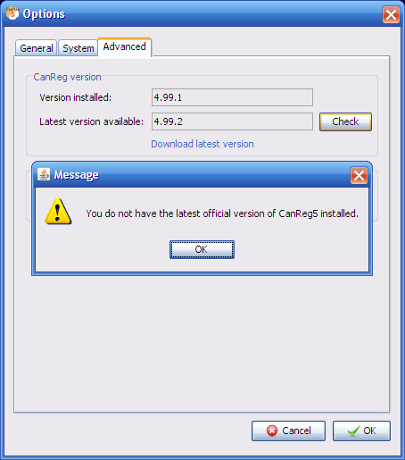

*[Table of Contents](README.md) · [Next: 2. Software Installation →](02-software-installation.md)*

---

# 1. What is CanReg?

CanReg5 is an open source tool to input, store, check and analyse cancer
registry data. It has modules to do data entry, quality control,
consistency checks and basic analysis of the data. The main improvements
from the previous version are the new database engine, the improved
multi user capacities and that the development is managed like an open
source project. Also included is a tool to facilitate the set up of a
new or modification of an existing database by adding new variables,
tailoring the data entry forms etc.

### A short introduction to the database structure in CanReg5

New in CanReg5 is the three level table structure. Where CanReg4 stored
everything in one big table of tumours, CanReg5 splits this information
in three tables: Patient, Tumour and Source. For each patient, you can
store as many tumour records as you need, and for each tumour you can
store as many source records as you need. This allows us to do more with
our databases, for example related to completeness by counting number of
sources, but it poses come problem that might require manual
intervention during the conversion process of a system from CanReg4 to
CanReg5.

For example, some of you might store multiple sources in each tumour
record in CanReg4. This should be split into several source records for
this tumour record in CanReg5, but this is not an easy task to automate
since all registries that have opted for this have solved it in a
different way in CanReg4.

One way around this is to put all the fields related to the source table
in CanReg5 so that you are sure not to loose any data, and then start
from the date you start using CanReg5 to store multiple source records
per tumour.

The best way, but a more time consuming one, is to set up the source
table (by editing the system definition XML) to only contain the data
you want to store per source and then work on the exported file from
CanReg4 and import additional source information at a later stage.
(General import of data is not yet functioning adequately in CanReg5 -
only import & migration of old data.)

You can of course choose not to use the source table, as well - just
record the source information per tumour like you would in CanReg4. This
can be set up while migrating your system definition files.

### Forum, Issue tracker, community site, twitter

We have created a project page at GitHub to help us keep track of issues
with CanReg5: <https://github.com/IARC-CSU/CanReg5>. Using tools there
allows you to see what error reports other CanReg users have already
filed and if solutions have already been proposed and also discuss
potential improvements for CanReg5, before posting your own queries.

You can of course still send us emails at <canreg@iarc.fr>.

If you encounter any problems please provide a description of it along
with the specifications of your computer. (Operating System (Windows XP,
Vista, 7, OSX, Linux?), memory, processor speed etc.) Also it would be
very useful if you can precise the **version** and the **build code** of
your CanReg5. This can be found on the bottom left of the welcome screen
and on the “About” screen. (For example Version: “4.99.0b586”)

Please be aware that some problems can be avoided by installing the
latest version of the Java Runtime Environment (Version 6 or newer)
before you start. (Available from
<http://java.com/en/download/manual.jsp>.)

Videos documenting certain operations described below can be downloaded
from: <http://www.iacr.com.fr/CanReg5/videos.zip> .

Last, but not, least: CanReg has its own stream on twitter. Please
follow: <http://twitter.com/canreg> for updates.

### Getting hold of the latest version of CanReg

If you are running version 4.99.1 (or newer) of CanReg, you can launch
CanReg and click “Options...”, go to the “Advanced” tab. (See There you
see your current version, i.e. 4.99.1. If you click “Check” CanReg will
look for an updated version. Afterwards you can click “Download latest
version” to get the zip-file containing the most recent version of
CanReg5.

<figure data-latex-placement="h">

<figcaption>Checking if you have the latest version of CanReg
installed.</figcaption>
</figure>

(If you have version 4.99.0 or no CanReg5 at all you can download the
newest version from here: <http://www.iacr.com.fr/CanReg5/CanReg5.zip>)

### Logfile

CanReg generates a logfile when you run it. This file is called
canreg5client.log and is located in your home folder. (On windows it is
most probably under C:\Documents and Settings\\ - you can access this by
browsing to %HOMEPATH% Depending on how you have configured your
computer it might show up as canreg5client.) If you can attach this to
emails with feedback/queries it would be very useful. Please note that
this file is overwritten each time CanReg is started, so you need to
“take it” just after, for example, your error occurs.

Example content of a log-file:

\<?xml version="1.0" encoding="windows-1252" standalone="no"?\>

\<!DOCTYPE log SYSTEM "logger.dtd"\>

\<log\>

\<record\> 

\<date\>2009-06-25T16:09:27\</date\>

\<millis\>1245938967921\</millis\>

\<sequence\>0\</sequence\>

\<logger\>canreg.client.CanRegClientApp\</logger\>

\<level\>INFO\</level\>

\<class\>canreg.client.CanRegClientApp\</class\>

\<method\>startup\</method\>

\<thread\>10\</thread\>

\<message\>CanReg version: 4.99.9b668 (20090625160546)\</message\>

\</record\>

...

\</log\>

# Installing and running CanReg5

---

*[Table of Contents](README.md) | [Next: 2. Software Installation →](02-software-installation.md)*
