*[← Previous: 2. Software Installation](02-software-installation.md) · [Table of Contents](README.md) · [Next: 4. Start & Navigation →](04-start.md)*

---

# 3. First Launch

### Run CanReg5

Go to the folder you installed CanReg5 in and double click on the coffee
cup icon (CanReg.jar). (**If, at this point, CanReg5 does not start you
might have to update your Java Runtime Environment and retry**. (See
<a href="#subsec:Java-Runtime-Environment" data-reference-type="ref"
data-reference="subsec:Java-Runtime-Environment">[subsec:Java-Runtime-Environment]</a>.)

You should now be presented with the CanReg5 welcome window (See figure
<a href="#fig:The-welcome-window" data-reference-type="ref"
data-reference="fig:The-welcome-window">1.1</a>).

<figure id="fig:The-welcome-window" data-latex-placement="h">

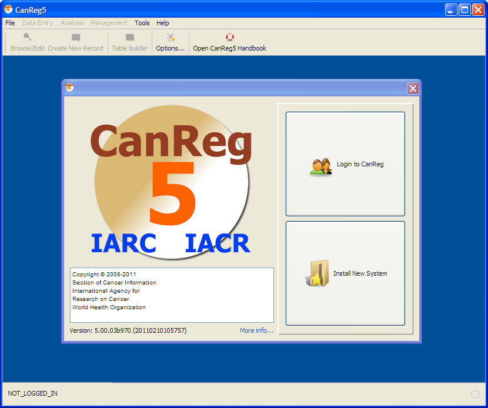

<figcaption>The welcome
window</figcaption>
</figure>

### Demo system

Included is the dictionary for the training system located in the
demo-folder in the zip-file. With this you can get a demo-system up and
running to test some data entry. To run this demo system, install the
TRN-file to set up the system. Afterwards you should import the
dictionary using “Data Entry” - ”Edit dictionary” and “Import complete
dictionary from a file”, before you start to enter data.

### Install a new CanReg5 system

If you want to install an already provided system definition (for
example the demo system TRN) please click “Install New System”. CanReg5
will present you with the following message:

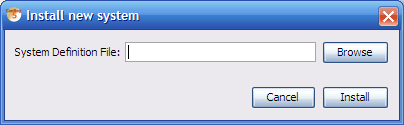

Click browse to find the system definition file. (If you want to use the
TRN demo system look in demo/database and select TRN.xml and click open
and then Install.)

If the XML file is associated with a backup of CanReg5 the program will
ask you if you want to restore from this backup.

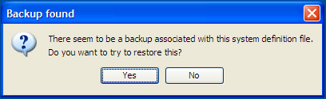

If you click yes CanReg will launch the server with the newly installed
system definitions and restore this backup.

### Convert the CanReg4 system definitions

If you have a CanReg4 system you can use tools built into CanReg to help
you migrate this to CanReg5.

First import the variables of CanReg4 to CanReg5 - the system definition
of CanReg4.

Go to “Tool” in CanReg5 menu and click “Convert system definition” (See
figure
<a href="#fig:CanReg-systems-definition-menu" data-reference-type="ref"
data-reference="fig:CanReg-systems-definition-menu">1.2</a>.)

<figure id="fig:CanReg-systems-definition-menu">

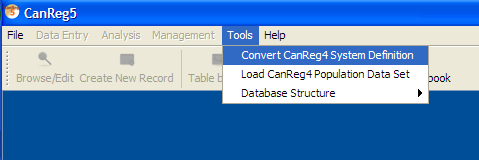

<figcaption>CanReg systems
definition converter menu</figcaption>
</figure>

Do “Browse” to find your CanReg4 system definition file. (This is a file
located in the folder \\\CR4SHARE\CANREG4\CR4-SYST\\ followed by your 3
letter registry code i.e. TRN whose name is ending in .DEF (i.e.
CR4-TRN.DEF).)

Select your CanReg4 file and double click it or click “Open”.

Click “Convert”.

The program will then ask you if you want to add this server to your
favourites. Click “Yes” here.

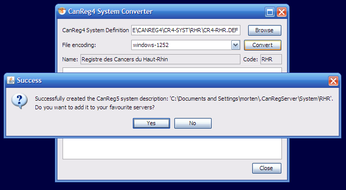

The next step is the trickiest one during the conversion. Since we go
from a tumour based database structure with only one big table with all
the tumour and patient related information to a structure with both a
table for tumour related information and patient related information we
need to specify what variable goes in what table of CanReg5. We
recommend putting the unique patient related information (name, date of
birth and follow-up variables) in the patient table, source information
in the source table and pretty much the rest (tumour information, age,
address etc) in the tumour table.

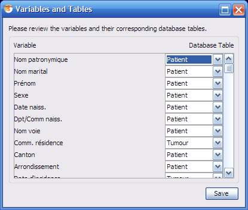

The program presents an initial proposal that you might agree with, but
please go through one by one the variables and decide.

Click “Save”. You have now created an XML file that describes your
CanReg5 system.

Optional: Before you proceed to the next step and launch the server you
can, if you want(!), manually edit this XML file you have created by
opening it in a text editor or a dedicated XML editor. The file is
located in your user folder under .CanRegServer. (On my machine, for
example, running Windows XP it is under: C:\Documents and
Settings\morten\\.CanRegServer\System.)

### Setting up or modifying a CanReg system using the built in editor

To modify an existing CanReg system or set up a new one you can use
tools built into CanReg5.

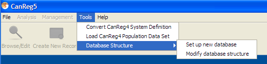

They can be found under Tools -$`>`$ Database Structure.

**Note: Before using this tool it is highly recommended to perform a
backup of your CanReg5 database!**

For now please use “Set up new database”. This will give you the Modify
Database Structure window.

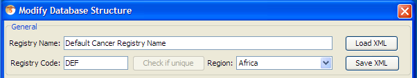

Please click Load XML and either pick your own XML or, if you start from
scratch, the TRN.xml or DEF.xml found in the CanReg installation. (You
will need to load an existing XML to be able to create a working XML for
your CanReg system.)

Please note that certain modifications done using this tool will impact
the structure of the CanReg database to such an extent that it will have
to be rebuilt afterwards. Others like renaming groups, changing the
displayed name of a variable or reordering the variables are purely
cosmetic and do not impact the database structure as such. If you wish
to do changes to the structure of the database you’ll need to export
your data prior to those changes, delete the database files of the
CanReg system, do required modifications using this tool or directly in
the XML, relaunching the CanReg server and then import the data (this
again will potentially have to be adapted to the structural changes).
CanReg will warn you if you have done changes that require a rebuild of
the database. (Fields with pink background in this editor - as well as
adding or removing variables, leads to this.)

When this has loaded you’ll see all the info specifying this CanReg
system. On the top you can specify the registry name, registry code and
region of the registry. Below you have a list of the Dictionaries, then
the Groups and then the Variables.

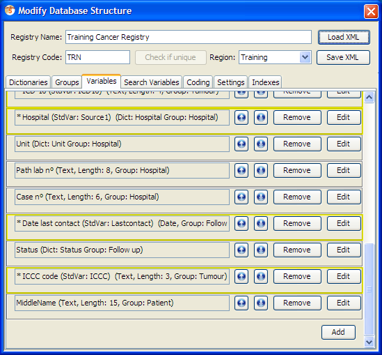

To add a dictionary, group or variable, click add in the proper pane.
This will then appear as the last item in the corresponding list for you
to edit.

Clicking edit on any button related to a dictionary, group or variable
brings up the respective editor.

#### Modifying a dictionary 

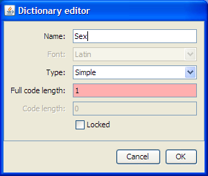

Using the dictionary editor you can modify any dictionary in CanReg5.
The fields are as follows:

**Name:** The name of the dictionary

**Type:** This can either be “Simple” or “Compound”. A “Simple”
dictionary is a plain list of codes and corresponding labels, whereas a
“compound” dictionary as two levels of refinement. For example the user
can pick the two first digits and then the last digit, as in the above
example.

**Full code length:** The number of character the codes for this
dictionary takes up in the database.

**Code length:** The number of characters in the first level of
refinement in the case of a compound dictionary.

**Locked:** Will you allow the super user to modify this dictionary
using the tools in CanReg, or should it be locked?

#### Modifying a group 

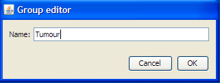

Using the group editor you can modify any group in CanReg5.

**Name:** The name of the group

#### Modifying a variable 

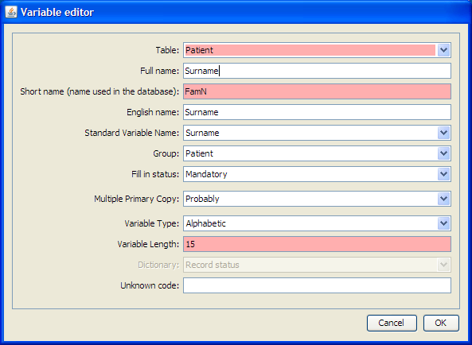

Using the variable editor you can modify any variable stored in the
CanReg5 database. The fields are as follows:

**Full name:** The name of the variable as displayed in data entry forms
etc.

**Short name:** The name of the variable in the database. (This should
be without any blanks and other special characters and reasonably
short.)

**English name:** It is useful to provide an English name for the
variable in case you want to collaborate with people in other countries.

**Standard Variable Name:** This maps the variable to a standard CanReg5
variable for the purpose of edit checks and analysis.

**Group:** The choice of group only affects the display during data
entry.

**Fill in status:** Can be set to “Mandatory”, “Optional”, “Automatic”
or “System”, depending on if you want to force the registrar to provide
this information before confirming the record.

**Multiple Primary Copy:** Legacy information. Leave as “Other”.

**Variable Type:** Can be “Alphabetic” (for plain text), “Asian text”
(legacy field, same as “Alphabetic”), “Date”, “Dictionary”, “Number” and
“Text Area”.

**Variable Length:** The length of the variable in characters.

**Dictionary:** If you chose “Dictionary” as type of variable you’ll
have to choose a dictionary here.

**Unknown code:** Here you can specify the unknown code of this
variable.

**Table:** Choose the table where this variable should be stored.

#### Set up person search variables 

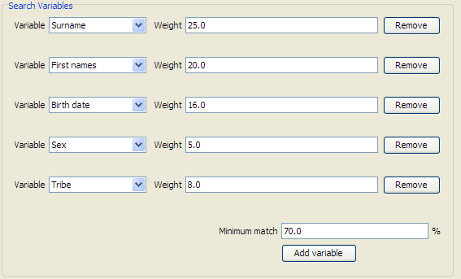

Using this editor you can change the variables that come into play
during person search in CanReg5, and their respective weights and
minimum match criteria.

#### Coding 

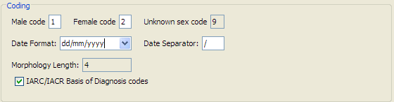

Here you can change some coding settings of your CanReg system. (Not yet
implemented.)

#### Settings 

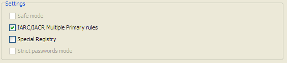

Here you can change some settings of your CanReg system. (Not yet
implemented.)

#### Saving the system 

By clicking Save XML the system XML will be saved to the system folder
of CanReg under the name $`<`$your system code$`>`$.xml (for example
TRN.xml), ready for use.

### Launching the CanReg server

After clicking “Login” on the welcome screen of CanReg you get the login
screen. To launch the CanReg server click “Settings”. Click “Launch
Server”.

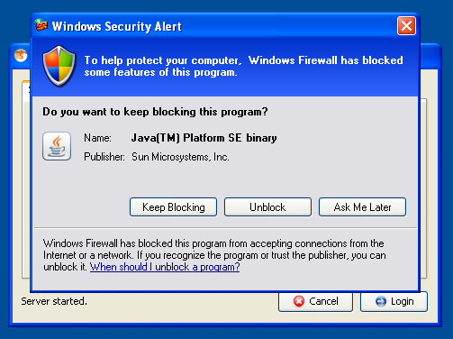

If you get a java firewall query, please confirm that it is OK that java
can comunicate through you firewall by clicking “Unblock”, “OK” or
“Yes”. If this is the first time you launch the server on this machine
it will automatically create the database needed for CanReg5.

If your database is encrypted you will get a message regarding this and
you need to provide the database password to open it. Please note that
this can be different from your user’s password.

When the CanReg5 server is running on your machine you should see an
icon in your notification area.

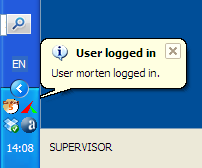

#### Launching server from command line

To launch CanReg5 from command line, you’ll have to open command line on
your computer (Windows: Win+R, “cmd”) change into the folder you have
*installed* CanReg5 (Windows: “cd %programfiles(x86)%\CanReg5”) and type
the following to launch the server:

“java -jar CanReg5.jar \<registry-code\>” (where \<registry-code\>
should be replace by the code of your registry, ie “java -jar
CanReg5.jar TRN-E”)

### Login

After launching the server you can log on to your CanReg system.

#### Locally 

If you want to log in to a CanReg server running on your local machine,
after either installing a CanReg5 system XML or converted your CanReg4
system definition files you go to the “System” tab of the “Login”-window
and choose your server from the drop down list. (Most probably already
selected.) (The default username is “morten” and password is “ervik”.
(All in small letters with no double quotes.) Click “Login” and you’ll
be logged on.)

If you get an error message saying “Could not log in to the CanReg
server on localhost with the given credentials.”, please make sure that
you have entered the correct username and password and that the server
is indeed running. (See “Launching the CanReg server” above.)

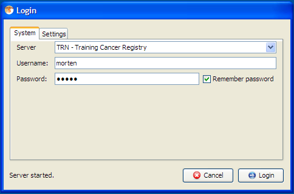

#### In a network 

If you want to log on to a CanReg server running on another machine in
your network you need to know the address of that machine. (Either it’s
IP address or name on the network.)

To find the IP address of a CanReg server you can go to the Settings tab
on the “Login”-window and tick “Advanced” to get access to some more
advanced tools, like the “Get IP Address” tool. Click this and you will
get a message saying “The IP address of (your machine) is
www.xxx.yyy.zzz. (Most probably something like 10.0.0.x or 192.168.0.x.)
Take a note of those numbers.

Launch CanReg on the machine you want to run CanReg on. Click “Login” to
get to the “Login” screen. There you can click “Settings” and type the
IP address, www.xxx.yyy.zzz, you found above in the “Server URL” field
along with the system code for your registry. (For example TRN.) If you
click “Add server to list” the program will test the connection to the
server and if this is OK this network server will be added to the list
of servers you can log in to from this CanReg installation.

Click the “System” tab and choose this networked server from the drop
down list of servers, enter username and password. (The default username
is “morten” and password is “ervik”. (All in small letters with no
double quotes.) Click “Login” and you’ll be logged on.) Click “Login”
and you’ll be logged on.)

If you get an error message saying “Could not log in to the CanReg
server on localhost with the given credentials.”, please make sure that
you have entered the correct username and password and that the server
is indeed running. (See “Launching the CanReg server” above.)

The next time you want to log on to this server all you have to do is
launch CanReg, select this server, enter username and password and click
“Login”.

Please note that you do *not* need to install the system definition or
convert from CanReg4. You only need the code (for example TRN) of the
CanReg system you want to connect to.

### Import the dictionaries from CanReg4

If you are migrating from CanReg4 make sure to export the most updated
dictionary from your CanReg4 system. (In CanReg4: “Data Entry”,
“Dictionary”, “Export dictionary to text file”) If you want to use the
demo system, the dictionary is located in: demo/dictionary.

- 

  Go to “File”, “Data Entry”, “Edit dictionary” in CanReg5

  

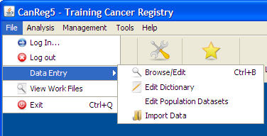

- 

  Click on “Import complete dictionary from file”.

  

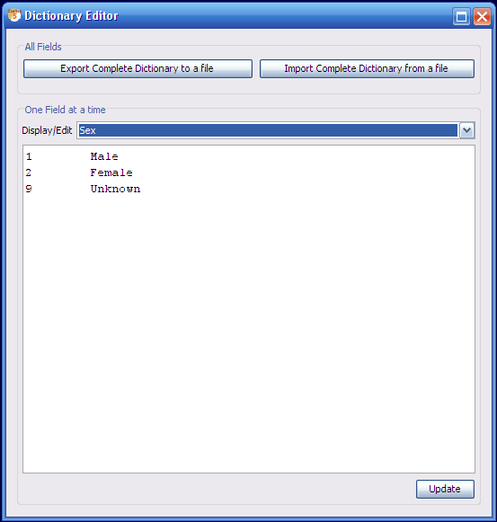

- 

  Browse and select the dictionary from you CanReg4 work folder or
  elsewhere.

  

- 

  Do Preview

  

- 

  Tick “CanReg4 Format” if you are migrating from CanReg4, leave
  unticked if you are using the demo system or otherwise are importing a
  CanReg5 formatted dictionary.

  

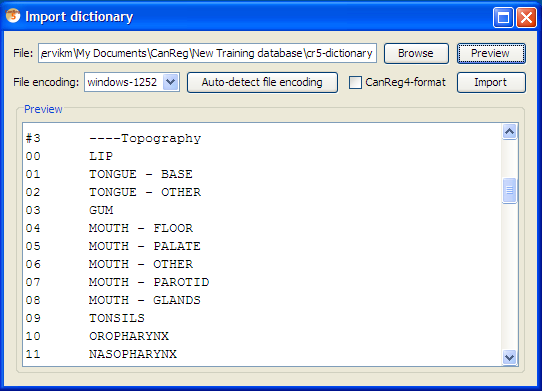

- 

  Click Import. This might take some time. Please note the bar in the
  lower right indicating that the program is busy.

  

- 

  Afterwards you will receive a message of success imported.

  

- 

  Click OK.

  

- 

  Go back to “File”, “Data Entry”, “Edit dictionary” and verify that the
  dictionaries have been imported.

  

### Import the data from CanReg4

Make sure to export the most updated data from your CanReg4 system.

- 

  In CanReg4: “Analysis”, “Export data”

  

- 

  Tick “Export all variables”.

  

- 

  Choose variables names short

  

- 

  **Under “Export File options” choose “Comma separated variables”**

  

- 

  Untick “Format date”

  

- 

  Untick “Correct Unknown”

  

- 

  Click “write data to file” and pick a file name that you can find back
  easily in CanReg5. For example on the desktop. Click “save”.

  

- 

  Take a look at the data you have now exported and close CanReg4.

  

- 

  Back in CanReg5 do “File”, “Data Entry” and “Import Data”.

  

- 

  The program will ask you if you have all your data in one file. Answer
  “yes” as this is the case when migrating from CanReg4.

  

- 

  Click “Browse” and locate the file from step A. Select it and click
  “Open”. You can if you want preview the file to see that you picked
  the right one and that the file looks OK. If for example Arabic names
  are garbled you should try to choose another “File encoding” (Default
  for Arabic text is ISO-8859-6).

  

- 

  **Set “Separating character” to Comma.** (Or whatever separating
  characters your file has.)

  

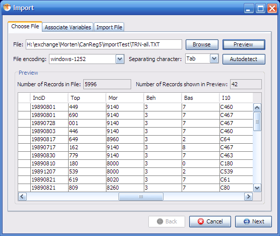

- 

  Click Preview to see that the data looks OK.

  

- 

  Click “Next” (or select the tab “Associate Variables”)

  

- 

  This lets you associate the variables in the file to import with the
  variables in the database. CanReg5 will find most of these
  associations by itself, but you should revise them to see if they look
  OK. Look for variable names in bold, as they are the one that are not
  assigned at all.

  

- 

  Click “Next” (or select the tab “Import File”)

  

- 

  Click “Import” (leave everything as by default – the import function
  only works on empty CanReg databases as per now…)

  

- 

  Let CanReg5 import the data (this might take a while) and click “OK”.

  

- 

  Click “Browse/Edit” and “Refresh Table” to see that the data has
  arrived well.

  

### Import data from other programs

You can import data from other programs than CanReg4 by using the import
tool in CanReg5. The only thing to pay attention to is that the data has
to be coded in exactly the same way as in the CanReg5 database.

- 

  Dates should be coded as year month day (yyyyMMdd) – ISO 8601

  

- 

  Topography in 3 digits ICD-O-3 with no leading C.

  

- 

  Morphology in 4 (or 5) digits ICD-O-3.

  

Other fields with dictionaries, like for example addresses should follow
the dictionary defined for them in CanReg5.

The data can either be in a single file as the example for CanReg4, or
in one separate file for patient-information, tumour information and
source information (with pointers to link sources to tumours and tumours
to patients).

# Working with CanReg5

---

*[← Previous: 2. Software Installation](02-software-installation.md) | [Table of Contents](README.md) | [Next: 4. Start & Navigation →](04-start.md)*
