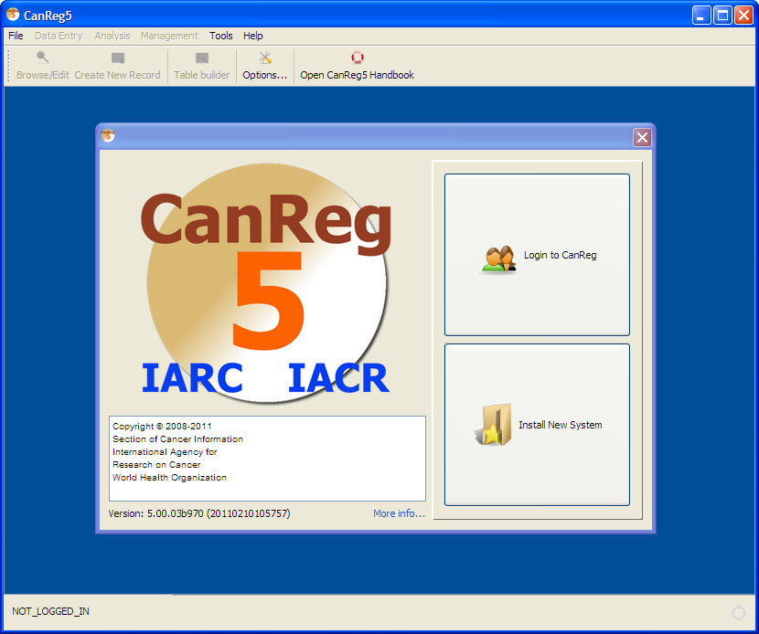
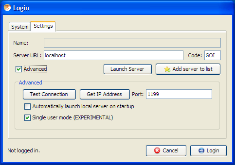

*[← Previous: 3. First Launch](03-first-launch.md) · [Table of Contents](README.md) · [Next: 5. Data Entry →](05-data-entry.md)*

---

# 4. Start & Navigation

## Welcome screen

There are two options in this CanReg5 welcome screen: "Login to CanReg"
and "Install New System".

## Login to CanReg

If CanReg5 has already been setup on this computer for your cancer
registry, then click on this option to pass to the "Login/Password"
panel. (See <a href="#subsec:Login" data-reference-type="ref"
data-reference="subsec:Login">[subsec:Login]</a> for more information.)

### Advanced login settings

<figure id="fig:Login-settings">

<figcaption>Login settings</figcaption>
</figure>

Under Settings you can tick Advanced to get access to some more advanced
settings for CanReg. (See figure
<a href="#fig:Login-settings" data-reference-type="ref"
data-reference="fig:Login-settings">1.1</a>.)

#### Test connection 

will test the connection to the server specified - without connecting to
it.

#### Get IP Address

will try to get the ip address of the URL specified in the Server URL
field. If this is set to localhost it will give you the IP address of
the machine you are on. This can be usefull when installing CanReg in a
network.

#### Port

lets you change the port the server is running on. This can be useful if
another program is running on the default port and you want to change
that or if you need to tunnel CanReg traffic through a VPN-network or
similar.

#### Automatically launch local server on startup

is by default ticked after installing a new XML. This does what it
says - it will try to launch the last used CanReg server on this machine
when starting CanReg. Basically it clicks “Launch Server” for you when
opening the login screen.

#### Single user mode

lets you log on to your CanReg system without starting the network
components. This can be useful if you are the only user on CanReg this
session. Like this you avoid network related errors due to for example
laptops falling asleep. Also, it is slightly safer, since you can be
sure that nobody can log on to your system but you (even if they have
gotten hold of your username and password and server address).

## Install New System

The CanReg5 program has been installed but you wish to add the Registry
definition for a particular Cancer Registry. To install a new system you
can use this module. Click browse and choose the XML-file that
corresponds to your system. (See
<a href="#subsec:Install-a-new" data-reference-type="ref"
data-reference="subsec:Install-a-new">[subsec:Install-a-new]</a> for
more information.)

---

*[← Previous: 3. First Launch](03-first-launch.md) | [Table of Contents](README.md) | [Next: 5. Data Entry →](05-data-entry.md)*
