*[← Previous: 4. Start & Navigation](04-start.md) · [Table of Contents](README.md) · [Next: 6. Analysis & Reports →](06-analysis.md)*

---

# 5. Data Entry

From the data entry menu you can open the Browse/edit data view, edit
dictionary view, edit population datasets view or import data view.

## Browse/edit

This part of CanReg5 allows you to view and edit the database records.

For Data Entry purposes, you can use this Browse part to look for a
particular record to Edit, or to see if a particular person has a cancer
notification already stored.

The table below shows the data - move (with the "Scroll Bars")
horizontally to see other variables, or vertically to view other
records.

You can use the Filter, Index and Ranges to select which records to
show, and the Variables radio buttons to select the variables columns.

Use these buttons to go to the Edit Form:

\- Create next record: If you have checked that the patient has no
record already, use this option to create a new blank edit form. The
next available registration number will be assigned when you save the
record.

\- Edit Table record: to edit the record highlighted by the blue bar in
the data table.

\- Edit/create Patient ID: Before clicking this button, fill in the
Registration number of the record you wish to edit. If the record exists
already, you can edit it; if not, this number will be assigned to a new
blank record. USE THIS OPTION TO SET THE REGISTRATION NUMBER FOR YOUR
FIRST RECORD.

\- Re-draw table:

If you have made changes to the database, use this button to update the
table displayed.

### Table

This lets you select the table to look at.

### Sorty by

The records will be ordered (or sorted) by the variable chosen.

### Range

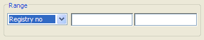

You can specify the Range start and end values for that sequenced
variable.

Example of how to use:

- Sort by Date of Incidence,

- show records of years 2000 and 2001 only:

- Range = Incidence Date

- Range Start = 2000

- Range End = 20019999

### Filter

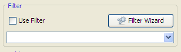

To select records. (Use "Range" as primary selection - it is quicker)

| Operator | Description |
|:--:|:---|
| = | Equal |
| \<\> | Not equal |
| \> | Greater than |
| \< | Less than |
| \>= | Greater than or equal |
| \<= | Less than or equal |
| BETWEEN | Between an inclusive range |
| LIKE | Search for a pattern (use % as wildcard) |
| IN | If you know the exact value you want to return for at least one of the columns. |

| Logical Operator |        Description         |
|:----------------:|:--------------------------:|
|       AND        |    match both criterias    |
|        OR        | match one of the criterias |

#### Examples of how to use

- sex = ’1’ (all male cases.)

- age \>= 60 (cases aged 60 and more.)

- sex = ’2’ and age \< 60 (female cases aged more than 60.)

- age BETWEEN 45 AND 60 (cases from patients aged from 45 to 60
  (inclusive))

- age \<15 OR age\>60 (patients aged less than 15 and more than 60)

- name = ’Smith’ (Name is “Smith”)

- name LIKE ’Sm%’ (Name begins with “Sm”.)

- basis = ’7’ or Basis = ’5’ (Basis is 7 or 5.)

- topog LIKE ’50%’ (for all Breast cases.)

### Filter wizard

<figure id="fig:Filter-Wizard">

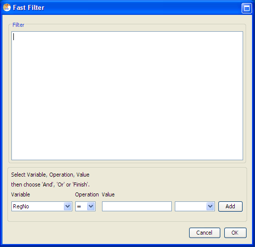

<figcaption>Filter Wizard</figcaption>
</figure>

The filter wizard is here to help you build filters. (See figure
<a href="#fig:Filter-Wizard" data-reference-type="ref"
data-reference="fig:Filter-Wizard">1.1</a>.) It is a fast method to
specify filter, or selection, criteria.

#### For example

, to select

Females over 60 years old.... (make sure you have selected
Tumour+Patient table)

Launch Filter Wizard and click on ...

1.  Variable - "Sex"

2.  Operator - "="

3.  Value - "Female" (from Dictionary)

4.  Logical Operator - "And"

5.  "Add"

6.  Variable - "Age"

7.  Operator - "\>"

8.  Value - type "60"

9.  "Add"

10. "OK"

For some combinations using "AND" and "OR" you may need to add brackets
after.

e.g.

Topog = ‘220’ AND (Basis=’1’ OR Basis=’2’)

### Display variables

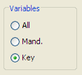

Click on a "radio button" above to display either:

\- All variables

\- Mandatory variables (those that MUST be filled in the Edit form)

\- Key variables (Names, Age, Date Incidence, Topog etc)

### Navigate buttons

Click on the Navigation buttons below to move record: Top, Bottom, Up,
Down.

## Edit record

To get to a data entry form either press Create New Record from the menu
bar

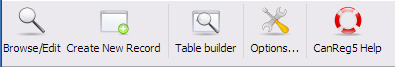

or enter a new record number in the browser and click “Edit Patient ID:”

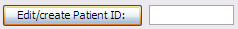

or double click on any record in the browser.

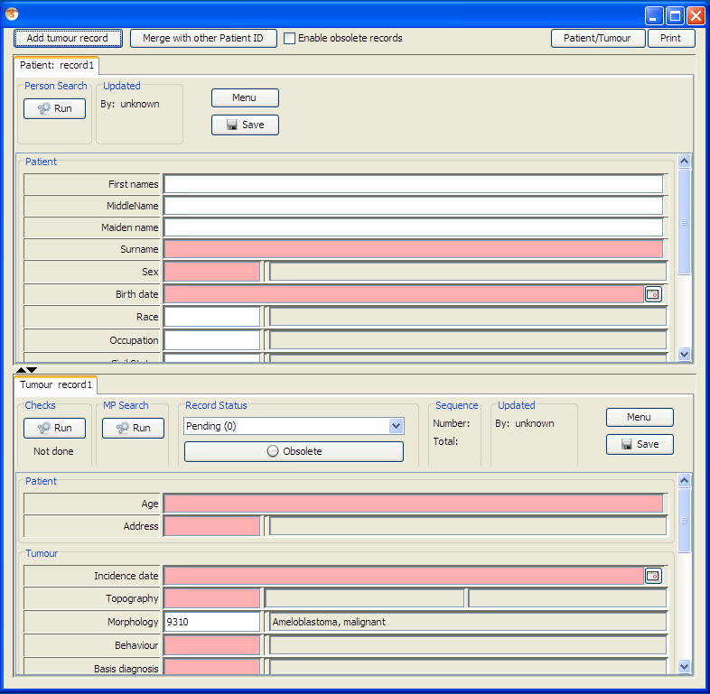

You can move around the Data Entry form in the following ways:

\- Tab and shift-tab to move to the next or previous variable;

With the mouse, simply click on the variable you wish to edit, or on the
dictionary box to select from the popup of the valid dictionary codes.

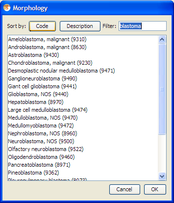

The pink fields are the mandatory ones. (Date format is still set to
yyyyMMdd, but this will be improved later.)

When you have finished entering the data, you must perform the checks as
described in the system variables part below.

### System variables

After data entry, you must perform the following steps:

##### Person Search

Searches for any records that might belong to the same person.

##### Check

Performs various consistency checks
(<a href="#subsec:Check" data-reference-type="ref"
data-reference="subsec:Check">[subsec:Check]</a>)on the data you have
entered.

##### Record Status

All new records are set to "Pending" and cannot be "Confirmed" until the
"Check" and the "Person search" have been successfully performed. Only
confirmed cases are used for analysis. Only a user with "Supervisor"
permission level can confirm rare or multiple primary cases, or delete
records.

##### Save

Save record to the database

The "Updated" box shows the date that the record was last edited and by
whom.

### Obsolete button. 

This will flag the record as obsolete, so that it will not show up in
analysis. It is a way to keep duplicate records that might contain
valuable information.

### Check

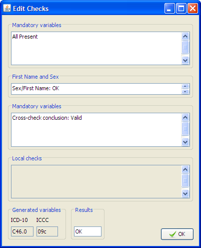

Any variables found in error or query will be marked in red in the data
entry form.

There are three sections to the checks:

##### Mandatory variables

Indicates any variables, defined as mandatory for your Registry, that
have not been filled in. If the value is really not available, then fill
in "9" or "99" etc. - the code for "Unknown".

##### First Name and Sex

Checks the combination of First Name and Sex. e.g. "Mary", "male" would
probably be an error! A name that is really used by both sexes can be
defined as "Unisex".

##### Cross checks

These are the same consistency checks as in the IARC Tools "Check"
program. Some combinations would be marked as errors:

e.g. Sex = Female and Topography = Prostate, while others could be
marked as "Rare". Only a Supervisor can confirm a Rare case.

As well as performing these checks, this function also determines the
ICD-10 code derived from the ICD-O Topography and Morphology.

For more information on these checks please see:
http://www.iacr.com.fr/TechRep42-MPrules.pdf

(The following checks are implemented in CanReg5: "Age and Morphology",
"Age and Topography", "Age, IncidenceDate, and BirthDate", "Age,
Topography, and Morphology", "Basis", "DateOfLastContact", "Grade",
"Morphology", "Sex and Morphology", "Sex and Topography", "Topography
and Behaviour", "Topography and Morphology", and "Topography".)

### Person search

The whole database is searched using probability matching for any
records that might belong to the same person. All personal data such as
Date of Birth, Place of Residence, Id Number, plus a phonetically
simplified form of the name are used in this search. (This can be
tailored by the administrator of the CanReg5 system.) Any other record
with a percentage match higher than the "Minimum Match" is displayed.

If no match is found, a message will be displayed to that effect.

Otherwise, the computer only displays possibilities - YOU must decide if
it really is the same person.

## Dictionary editor

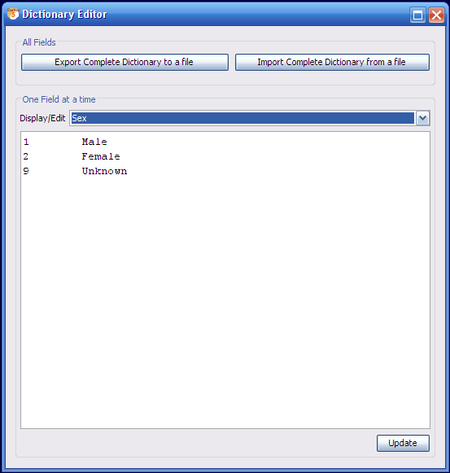

The dictionary editor lets the supervisor users edit the coding schemes
of the various variables in CanReg5.

### Export Dictionary to file

Export the current set of CanReg5 dictionaries to a tab-separated file
for editing in for example Excel.

### Display/edit … Select

This will display any dictionary picked by the user for editing directly
in CanReg. The format will be standard tab-separated values so that the
user can also copy and paste this into general spreadsheet applications.

### Update

This will import the dictionary picked by the user from the text area.
The format must be tab-separated values. This means that the users can
copy and paste directly form general spreadsheet applications (i.e.
Excel).

### Import Dictionary from file

Import a complete set of CanReg5 dictionaries from a tab-separated file.
(Or a two-space-separated CanReg4 dictionary.)

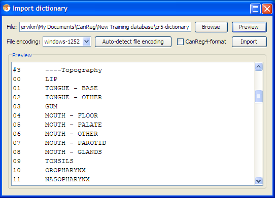

## Population Dataset Editor

### Manual entry/validation

The Population Dataset editor lets you edit population data set to be
used in the table builder. This is located under File – Data Entry Edit
Population Dataset:

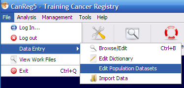

When you start it you get to the list of all your population datasets.

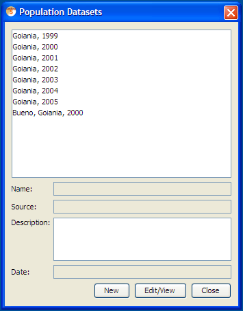

Add one by clicking New. This opens the Population Dataset editor:

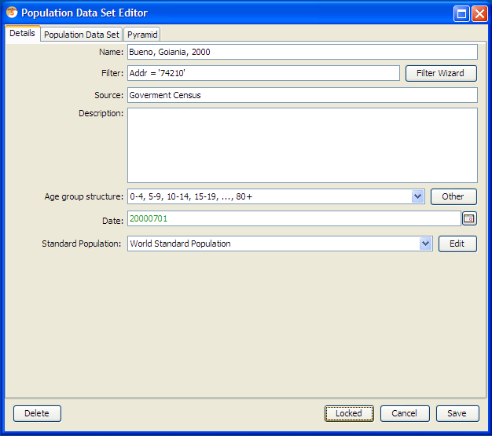

Fill in the details:

- 

  A name for the dataset

  

- 

  "Filter" or selection criteria, so the program only selects records
  corresponding to the population (e.g. Address code \>= 10 and Address
  code \<= 19) (Basically if it does not cover your entire area of your
  database.)

  

- 

  A source of this data (e.g. whether Goverment Census, or Estimation).

  

- 

  Some description (less than 255 characters)

  

- 

  Choose the age group structure.

  

- 

  Set the date when the population was at this amount. (In the example
  above it is mid 1992)

  

- 

  The Standard population used for ASRs when building tables with this
  set.

  

"Age Standardised" rates are calculated in order to compare rates from
different countries that have different age profiles. Normally the
"Standard" population is the World standard included here. (If you wish
to change this, choose another standard population (or click on the
standard pop.”Edit” button.)

Then fill the population dataset itself:

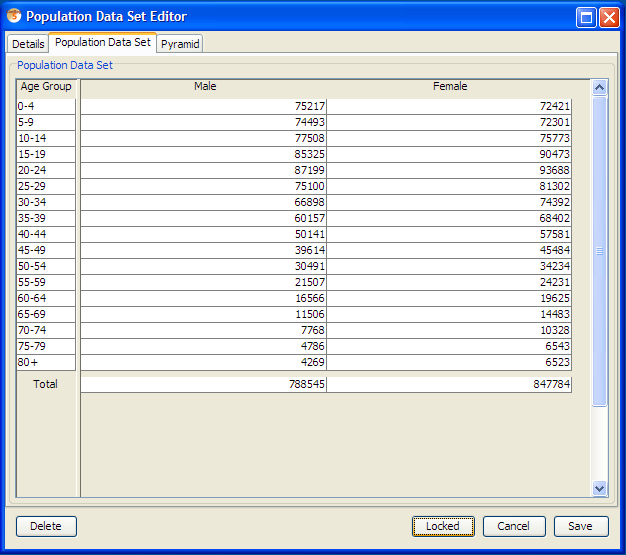

(Please note that you can copy and paste population datasets back and
forth from general spreadsheets like Excel.)

Click save to save your population dataset to the database.

You can also take a look at the population pyramid of the current
population data set by going to the Pyramid tab.

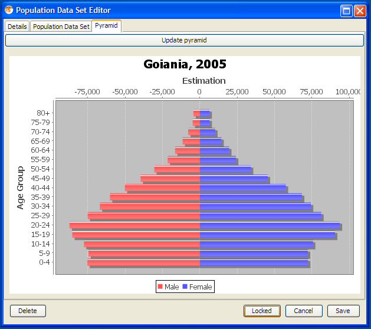

This can be saved as an image to disk by right-clicking on the image and
choosing “Save as PNG...”

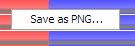

And choosing a proper file name.

### Import population data set from CanReg4 

Alternatively you can import population data sets from CanReg4. To do
this you go to the Tools menu and choose “Load CanReg4 Population
Dataset”.

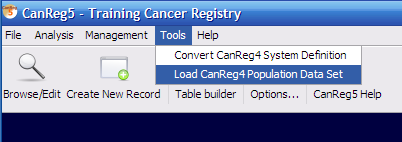

Click Browse to find the population dataset:

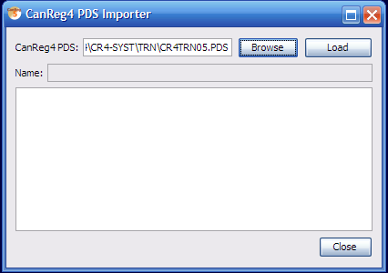

Then click Load and a confirmation message that the population dataset
has been loaded will appear.

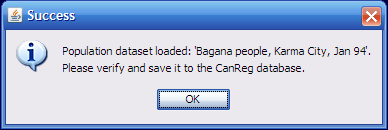

Click “OK”.

Next step is to revise the population dataset and see to that it has
been imported correctly.

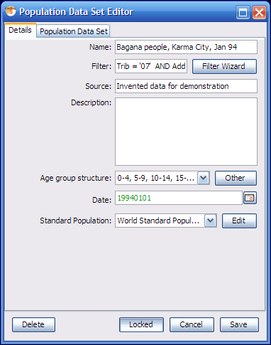

One important thing to do is to see to that the filter is correct. That
for example the search variables are enclosed by ’s. If you need to
change anything in the dataset you need to unlock it by toggling the
“Locked”-toggle.

## Import

The import function lets you import data from other CanReg systems or
other programs.

(For a detailed walk through of how to get the data from CanReg4 to 5
see <a href="#subsec:Import-the-data" data-reference-type="ref"
data-reference="subsec:Import-the-data">[subsec:Import-the-data]</a>.)

Data in an external file may be added to the CanReg database by
importing. It should be of the following format:

- Tab delimited

- Comma Separated Variables

- Character delimited

The easiest way is to have the variable names at the top of each column.

There are four main steps to importing a data file. (If you don’t have
all your data in one file, but rather one file per table you need to
repeat the first two steps for each file.)

1\) Choose the file(s).

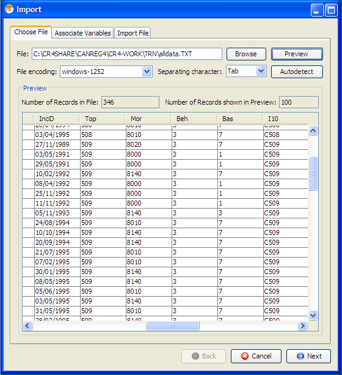

Here you also might need to specify the character encoding of your file
as well as the separating chacter used, if CanReg does not detect it
automatically. Please verify using preview.

2\) Identify the variables.

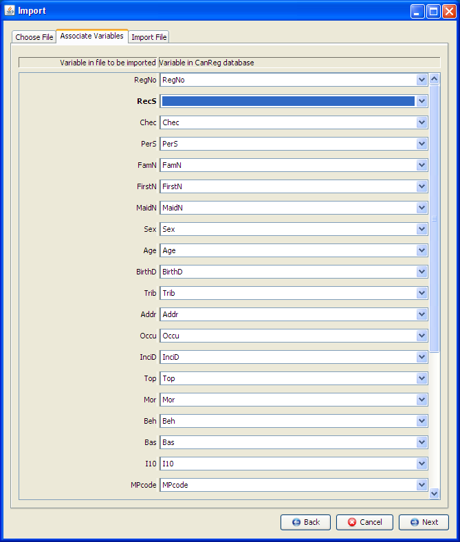

3\) Choose the various options - see specific helps.

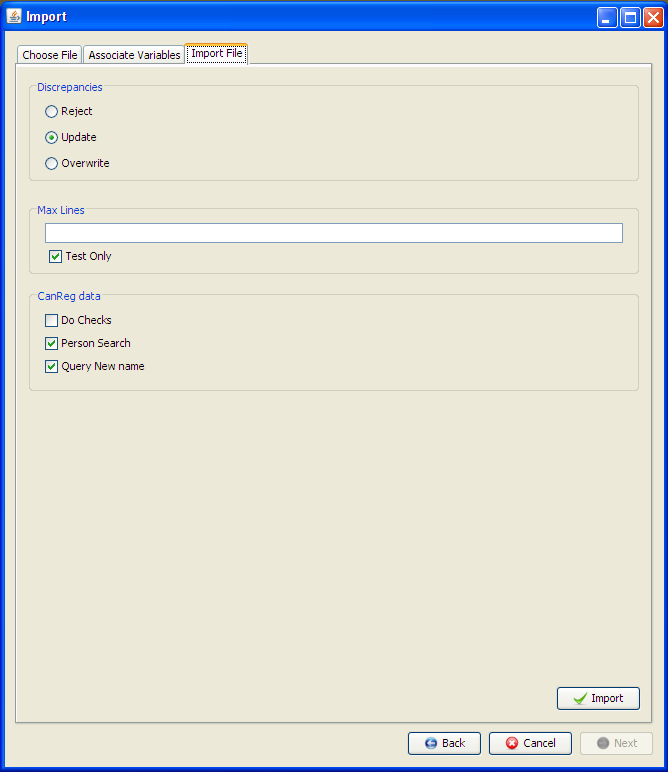

4\) Import the file (maybe in "test only" mode first)

### Discrepancies

A discrepancy is when a record is found with the same registration
number as one in the database, but there are differences in some of the
data.

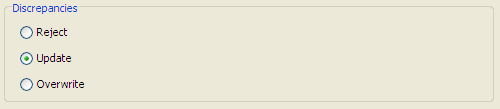

Click on a "radio button" to either:

- Reject these discrepancies (they will not be imported)

- Update them (any new data will be copied over to the database record)

- Overwrite (ALL variables will be copied over, even empty ones)

### Max. Lines / Test only

For testing purposes, you may wish to specify how many lines of the
import file to read.

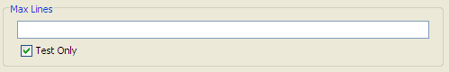

With "Test only" ticked, NO data is actually added to your database;
only a report is generated showing what WOULD happen. It lists
discrepancies, possible matches, rare or error cases etc.

### CanReg DATA

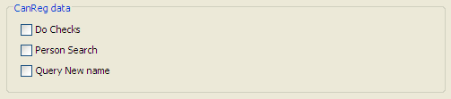

#### Perform Checks

If the data to import was not created using CanReg, or if it is a
Pending case, then the Checks must and will be performed.

If however, the case has already passed the Checks, the Checks will NOT
be performed again unless specified by ticking this option.

#### Perform Person Search

Normally, when importing CanReg data, the Person Search will still be
performed even if already done. If this option is NOT ticked, then the
Person Search will NOT be repeated in this case. This is only advisable
is the case of having no original data.

#### Query New First Name

For data that has not already passed the checks, the First Name and Sex
combination will be checked and updated. Tick this option if you wish
all NEW names to be set as pending.

If you are starting a new registry then you probably don’t want all new
names to be set as pending, however, if you have several years of data
already, then it would be advisable to query names not already known.

---

*[← Previous: 4. Start & Navigation](04-start.md) | [Table of Contents](README.md) | [Next: 6. Analysis & Reports →](06-analysis.md)*
