*[← Previous: 5. Data Entry](05-data-entry.md) · [Table of Contents](README.md) · [Next: 7. Management & Quality Control →](07-management.md)*

---

# 6. Analysis & Reports

## Export data

To export (write out) all, or part of, your CanReg5 data to an external
text file.

There are two main reasons for doing this:

- To be able to *import* the file into another program (e.g. *Stata*,
  *SPSS*, a general spreadsheet like *Excel* or *Calc* or *Access*) for
  further analysis.

- To produce a report, or case listing, that could be read into *Word*
  and printed out.

To export your data go to Analysis -\> Export Data/Reports:

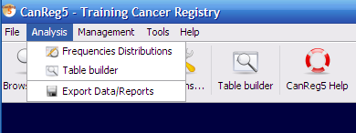

You will be presented with a screen that resembles the browse-screen:

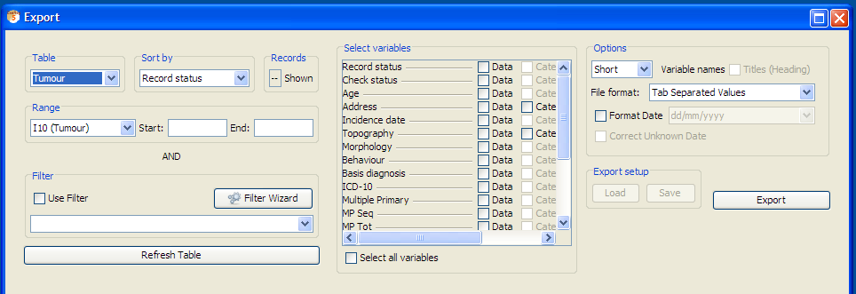

The following steps need to be taken:

- Specify the records you want to be selected by using the
  Filter(<a href="#subsec:Filter" data-reference-type="ref"
  data-reference="subsec:Filter">[subsec:Filter]</a>) and
  Range(<a href="#subsec:Range" data-reference-type="ref"
  data-reference="subsec:Range">[subsec:Range]</a>) options, and the
  order in which they will be written using the Sort
  by(<a href="#subsec:Sorty-by" data-reference-type="ref"
  data-reference="subsec:Sorty-by">[subsec:Sorty-by]</a>).

- Select the
  Variables(<a href="#subsec:ExportVariablesSelector" data-reference-type="ref"
  data-reference="subsec:ExportVariablesSelector">[subsec:ExportVariablesSelector]</a>)
  to display.

- Choose the Variable headers to include.

- Choose the File Format
  (<a href="#subsec:Export-file-format" data-reference-type="ref"
  data-reference="subsec:Export-file-format">[subsec:Export-file-format]</a>)
  suitable for your needs.

Please note that some of the functionality, like the ability to store
export-setups is not yet implemented.

### Options

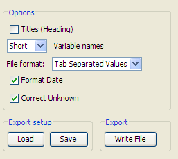

### Export file format

All file formats produce text files, with one case per line (a new line
at the end of each case). They all have default extension .TXT except
for "Comma Separated Variable", which has .CSV. "Tab Delimited" writes
each variable separated by the TAB character. "Comma Separated Values"
encloses each variable in quotes, and separates by a comma.

If you export data to a “Tab Separated” or a “Comma Separated” file you
can open this in general spreadsheets (like *Excel*).

### Titles, variable names

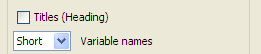

#### Titles 

Will write at the top of your export file:

- the filter criteria, index and ranges used,

- today’s date.

This option is useful is you are writing a report, or case listing. (Not
yet implemented.)

#### Short variable name 

Puts the abbreviated names of the variables at the top of each column.
(If this file were imported into, for example *Access* or *R* then these
would automatically become the names of the variables.)

#### Long Variable name 

Writes the full name of the variable at the top of each column.

### Variables

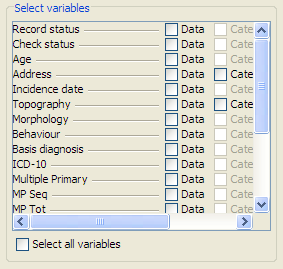

Select the variables to export.

Tick the boxes next to the variable name to select (or deselect). They
will appear in the data grid after you have clicked refresh table. (Note
that even though you select to export the category names or descriptions
they only show up as codes in the preview window.)

You can drag the grid columns to change the order of the variables.

Click on "All variables" to select them all.

### Date Format

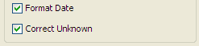

Tick "Format Date", for example, to export "21/04/2001" instead of
numeric form "20010421". (The date format can be any format specified by
a text string using dd for days, MM for months, and yyyy for year, for
example: “yyyyMMdd” (the default), “dd/MM/yyyy”, or “MM.dd.yyyy”.)

Tick "Correct Unknown" so that unknown day will be written as "01" and
unknown month as "07". This is necessary if you wish to import the data
into *Excel*, or any other software that will reject invalid dates.
(Please note that you lose information on what dates are unknown and
what dates are really mid-year.)

### Export setup

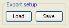

This module is used to load previously made export settings or save the
current settings. This includes the filter, the sequence, the variables
to export and the various options. (Not yet implemented.)

## Table builder

The Table builder (See figure
<a href="#fig:Table-builder" data-reference-type="ref"
data-reference="fig:Table-builder">1.2</a>) lets you build incidence
tables etc in CanReg. You find it under analysis –\> table builder.

<figure id="fig:Table-builder-in-the-menu">

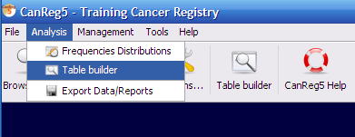

<figcaption>Table builder in the
menu.</figcaption>
</figure>

### Example

When you start it you first choose the type of table you want to
produce. (Please note that not all the tables in the list has been
implemented.)

Pick Incidence per 100,000 by age group (Period):

<figure id="fig:Table-builder">

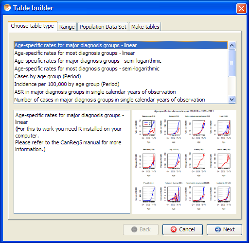

<figcaption>Table builder</figcaption>
</figure>

The incidence rate is defined as:

$`\frac{incidence\:cases\:per\:year}{population\:at\:risk}\times10000`$

This gives an idea of the risk of getting each type of cancer - the
tables consist of Incidence Rates by Sex, Age group and ICD10 cancer
type.

Click on range to set the range of your analysis and set it to match the
analysis you want to do, for example here we want to look at Karma City,
1991 to 1993:

<figure id="fig:The-range-chooser" data-latex-placement="h">

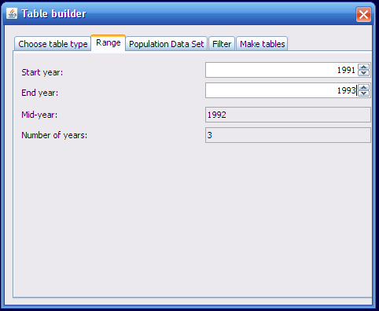

<figcaption>The range
chooser.</figcaption>
</figure>

In order to create tables of incidence rates, we need to know the size
of the population at risk. Therefore, a "Population Data Set" is needed.

Click “Population Data Set”. Pick one population data set per year.
(Please note that this can be the same for all three if that year is
representative of the period. See figure
<a href="#fig:The-population-dataset" data-reference-type="ref"
data-reference="fig:The-population-dataset">1.4</a>.

<figure id="fig:The-population-dataset" data-latex-placement="h">

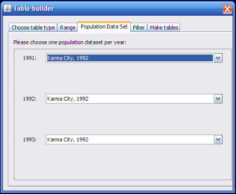

<figcaption>The population dataset
chooser.</figcaption>
</figure>

Then you can go to the Make tables tab to generate the actual tables.
Click “Generate post script (PS) files” (See figure
<a href="#fig:File-formats-selector" data-reference-type="ref"
data-reference="fig:File-formats-selector">1.5</a>.) and choose a file
name. (If the table generates more than one file (like it is the case
for incidence per 100,000 some number or text will be added to the name
you give for each file.)

<figure id="fig:File-formats-selector">

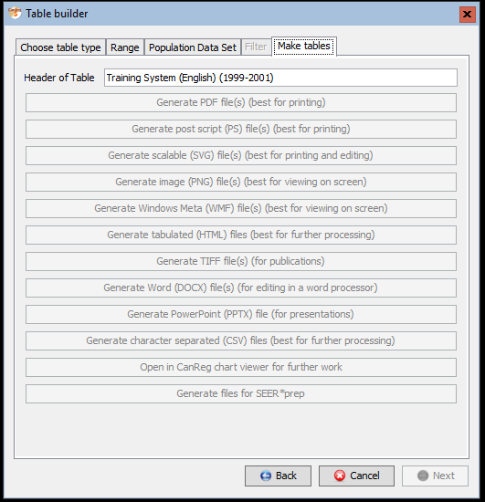

<figcaption>File formats
selector</figcaption>
</figure>

You get a message saying, “Tables built.”

Click OK and if you have a program that can read PostScript (See page .)
files the tables will be displayed after you press OK. (You might have
to go to the Orientation menu in *GSView* and choose Portrait to get the
table in the proper orientation.)

<figure id="fig:Incidence-Rates-per">

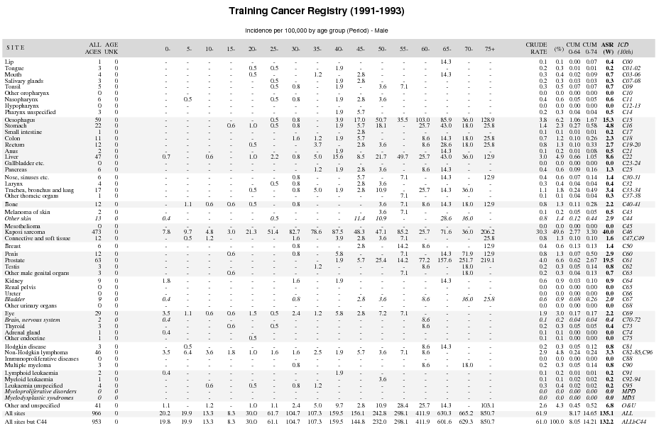

<figcaption>Incidence Rates per
100.000</figcaption>
</figure>

### File formats

The various tables can be generated in various file formats, depending
on what they support.

#### Portable Document Format (PDF)

PDF is a well known standard document format that can be read in for
example Adobe Reader, installed on most computers

#### Post Script (PS)

Post Scipt is the predecessor of PDF and is an open format that can be
displayed using for example GSview.

#### Scalable Vector Graphics (SVG)

Scalable Vector Graphics, or SVG, is a scalable editable file format
that lets you further tailor the graphics. This can be viewed in many
programs, incuding most modern internet browsers (as it is part of the
HTML5 standard), and further edited in programs like InkScape or Adobe
Illustrator. They can also be directly embedded in many documents using
Google Docs or Open Office.

#### Image files (Portable Network Graphics (PNG), Windows Meta files (WMF) or TIFFs)

Image files are useful for presentation on screen or online, but less
adapted to print, as they are not scalable. (If possible it is best to
use PNG as that is an open format.)

#### Tabulated data (HTML)

This is the data from the tables in HTML format for further processing.

#### Word files (DOCX)

This generates a word document that can be edited in any compatible
software. (Microsoft Word, Libre Office Writer, Open Office Writer,
etc.)

#### PowerPoint (PPTX)

This generates a slide deck that can be edited in any compatible
software. (Microsoft PowerPoint, Libre Office Impress, Open Office
Impress, etc.)

### CanReg5 Chart Editor

CanReg5 has a built in chart editor for charts that support it. Using
this you can preview and modify the chart before saving it as PNG, PDF
or SVG or printing it. (See figure
<a href="#fig:CanReg5-chart-editor" data-reference-type="ref"
data-reference="fig:CanReg5-chart-editor">1.7</a>.)

<figure id="fig:CanReg5-chart-editor" data-latex-placement="h">

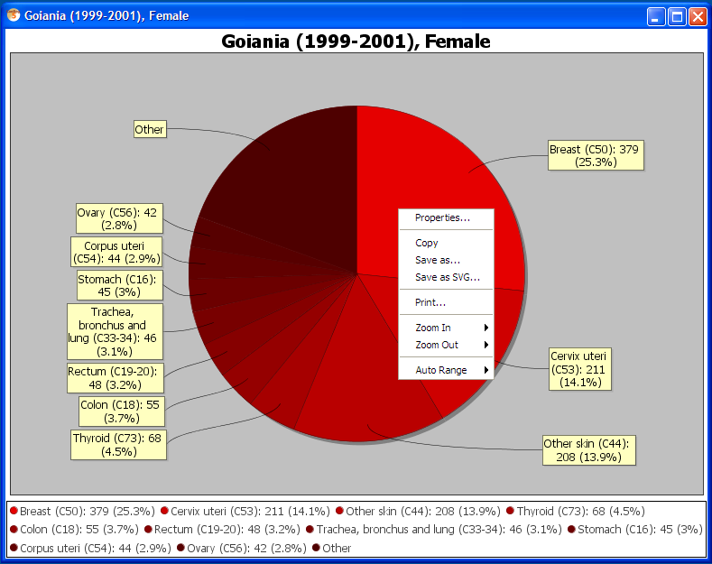

<figcaption>CanReg5 chart
editor</figcaption>
</figure>

### CanReg and SEER\*Stat

CanReg provides a facility to export data to be used in the free
SEER\*stat. (Windows only.) To do so you’ll have to first get hold of
and install SEER\*Stat and SEER\*Prep from the SEER website.
(<http://seer.cancer.gov/seerprep/> and
<http://seer.cancer.gov/seerstat>)

#### In CanReg

Afterwards you can use the table builder in CanReg and choose the
SEER\*Prep as table type, specify the range of years you want to look
at, the population datasets matching each year in the period and click
“Generate files for SEER\*Prep”. This will ask you to specify the base
name of the files for SEER\*Prep, i.e. “Training Database 1999-2001”.
(Please note that you can only use ASCII (English) characters in the
paths of the datafiles.) CanReg will add “cases-” and “pop-” for
respectively the incidence file and the population file, as well as the
suffix “.txd” so that SEER\*Prep recognises the files. CanReg will also
create a file describing the data for SEER\*Prep - a socalled .dd-file.

Start SEER\*Prep.

#### In SEER\*Prep

<figure>

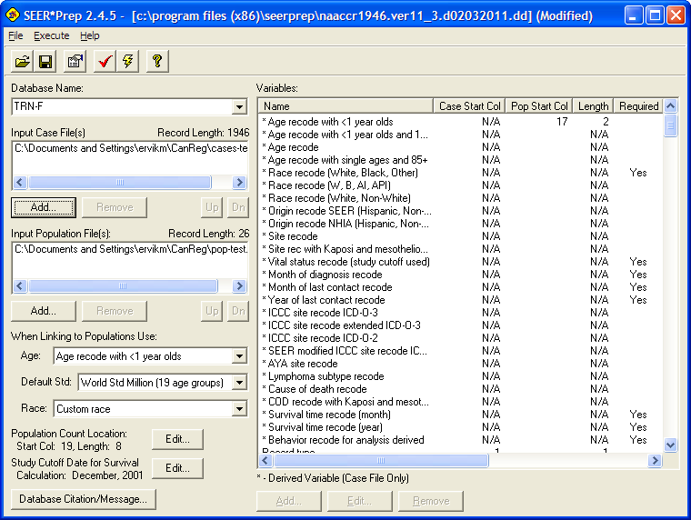

<figcaption>SEER*Prep in action</figcaption>
</figure>

Load the .dd file you created with CanReg using the little folder icon.

Click “Edit...” on the study cutoff date for survival and set it to
something after the last entry in the database. (The date of the
export?) (This is not important for now as the survival features in
SEER\*Stat is not valid for data from CanReg yet.)

Click the “Lightning” button. (Or go to the “Execute” menu and choose
“Create file...” SEER\*Prep will then ask you where you want it to write
it’s report file. Choose somewhere you’ll be able to find it back, i.e.
the Desktop. (If you have already created a database with this name,
SEER\*Prep will ask you if you want to overwrite it. Choose “yes”, if
you want.)

Next you get some choices regarding invalid values. (The first time you
might want to choose “Do not exclude any records”.)

That’s it. SEER\*Prep will generate the files that SEER\*Stat needs.
Exit SEER\*Prep and start SEER\*Stat.

(A more detailed walk through on this process can be found here:

<http://seer.cancer.gov/seerprep/example.html>)

#### In SEER\*Stat

Your data from above should now appear in SEER\*Stat under the name you
chose for the database above ready to be exploited in SEER\*Stat.

You might have to create a new profile, by going to the “Profile” menu
and choosing “Add New...”

Click “Add Local...” for Data Locations and choose the folder that
SEER\*Prep writes data to.

(You can also untick the Client-Server ssp-connection if you want.)

Under “Other variables” you have to specify valid paths for the “User
Variables”, “Open or Save” and “Temporary Files”.

### Launch browser

This launches your web browser for an interactive data analysis session.

Note: Your data is kept on your local machine even though it is accessed
using your web browser.

## Frequency distributions

Frequencies distributions let you look at the data in your database as
frequencies by year. You can cross-tabulate several variables. To start
this module go to Analysis – Frequencies Distributions:

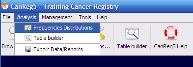

If you click Refresh table with no filter and no selected variables you
get a table of cases per year.

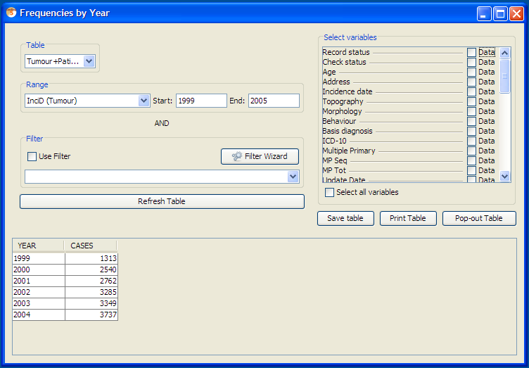

You can sort by any field by clicking its header. For example by number
of cases:

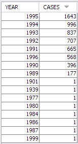

You can filter the result by adding a filter like for example on
incidence date. You can also add as many variables as you want.

With the save table button you can write the table to a comma separated
file (.CSV) that can be opened in most porgrams (*Excel*, *Stata*,
*R*...) for further analysis.

The table can also be selected and copied and pasted into *Excel*, for
example. (No right-click shortcut for that is implemented yet, but you
can select the lines you want and press Ctrl-C (on Windows and Linux) or
Apple-C (on Mac) and paste it into other programs.

### Pivot tables

If you save a table with only one stratifier (selected variable) CanReg5
also saves a pivot table based on the data in the table. Here’s an
example with the sex variable:

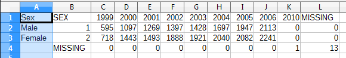

---

*[← Previous: 5. Data Entry](05-data-entry.md) | [Table of Contents](README.md) | [Next: 7. Management & Quality Control →](07-management.md)*
