*[← Previous: 6. Analysis & Reports](06-analysis.md) · [Table of Contents](README.md) · [Next: 8. Frequently Asked Questions →](08-faq.md)*

---

# 7. Management & Quality Control

### Back up and restore

Backup-functionality can be found under the Management menu.

#### Perform backup 

Under “Management” click “Backup”

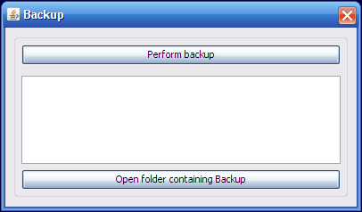

Then click “Perform backup”. This creates the backup of the CanReg5
database on the server machine. If you are on the server machine, you
can see the files you created by clicking “Open folder containing
Backup”. It is stored in the **CanReg server** folder under Backup and 3
digit code of the registry and then the date of the backup. On my
machine, for example, it is “C:\Documents and
Settings\morten\\.CanRegServer\Backup\TRN\2009-01-14”.

#### Restore from backup 

If you are on the server machine you can restore the backup you created
above by clicking “Restore” in the “Management”-menu restore your
Registry definition, population dataset, dictionary codes and any data
from a CanReg5 backup.

You will probably perform this either:

- at first installation, or

- if re-installing on a new computer, or

- recovering from a lost or damaged computer situation.

There are two ways to do this. The easiest one is to use the tool
“Install new system” that we have access to when CanReg launches.

##### Restore with “Install new system”

Click “Install new system” and browse to the XML file describing this
system and click Open. If this is part of a backup CanReg will tell you
that a backup has been detected and asks you if you want to restore
this. Click yes and it will restore this.

##### Restore with “Restore from backup”-tool

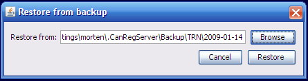

Simply choose the folder corresponding to the backup you want to restore
using the “Browse” button or enter the path manually and the click
“Restore”. You need to specify the folder containing a folder with a
folder named your registry code. That is most of the time the date of
backup. In the example above we restore a backup from january 2009. If
you select the folder within this “date” folder you will get an error
message and the restore will not be performed.

### Manage users

The user manager is located under management – users:

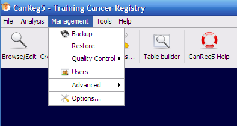

#### Change your own password 

To change your own password, go to the Current user tab in the user
manager and enter your new password twice. (See figure
<a href="#fig:Change-your-own-pqd" data-reference-type="ref"
data-reference="fig:Change-your-own-pqd">1.1</a>.)

<figure id="fig:Change-your-own-pqd">

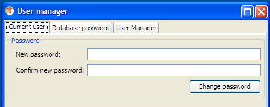

<figcaption>Change your own
password</figcaption>
</figure>

#### Database password

The CanReg5 database can be encrypted using DES or AES encryption with
keys up to 512 bits. To enable this you need to provide a minimum 8
characters long password on the “Database password” tab. (See figure
<a href="#fig:Set-database-password" data-reference-type="ref"
data-reference="fig:Set-database-password">1.2</a>.) This protects your
database in case somebody gets hold of it. The user will now be asked
for this password everytime she launches the server. (Once it is running
others can connect to the database as usual.) This is a one way
process - the only way to remove the encryption of your database is to
export all the data, build an empty database and import everything
again. The password can, however, be changed at any point in time.

Please note that if you loose this password you loose access to all the
data in CanReg! (And it is nothing that can be done about it.)

This functionality is only available to users with supervisor access.

<figure id="fig:Set-database-password">

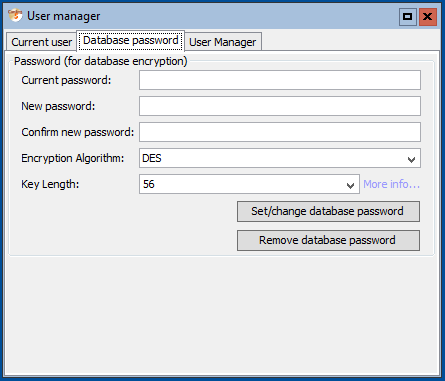

<figcaption>Set database
password</figcaption>
</figure>

Note: “To use the AES algorithm with a key length of 192 or 256, you
must use unrestricted policy jar files for your JRE. You can obtain
these files from your Java provider. They might have a name like "Java
Cryptography Extension (JCE) Unlimited Strength Jurisdiction Policy
Files." If you specify a non-default key length using the default policy
jar files, a Java exception occurs.” (Ref:
<https://db.apache.org/derby/docs/10.9/devguide/cdevcsecure67151.html>)
Simply download the Java Cryptographic Extension (from
<https://www.oracle.com/technetwork/java/javase/downloads/jce8-download-2133166.html>
if you’re using Java 8.), unzip the archive and copy the .jar files to
the “lib” folder inside your CanReg5 installation.

#### User manager 

If you are logged in with Supervisor rights you have access to the User
manager part of the user manager. (See figure
<a href="#fig:User-manager" data-reference-type="ref"
data-reference="fig:User-manager">1.3</a>.) This allows you to add and
delete users. Each user has their own login name, password and
permission level.

- A Supervisor can use all options;

- A Registrar can perform most of data entry except to confirm rare
  cases or possible duplicates. Changing the Dictionary and User
  Administration (adding users, changing user levels) are also
  prohibited.

- An Analyst cannot make any changes to the database. Only analysis
  options are available.

<figure id="fig:User-manager">

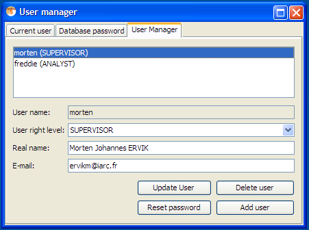

<figcaption>User manager</figcaption>
</figure>

To add a new user, click “Add user” fill in the user’s login name. This
will create a default user with registrar permissions. To change this
select the user and pick a suitable user right level and click “Update
user”.

You can change a permission level for a user and hit "Update user", or
delete a user by selecting the user and then clicking the "Delete"
button. The default password of any user is its user name. This should
of course be changed at first login by the user himself.

### Quality control

#### Name and sex

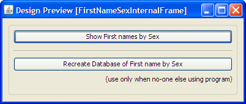

Click the button "Show First names by Sex" to view all the names used in
your registry:

- Male names

- Female names

- Unisex names (used by both sexes)

You should periodically review these lists to check for obvious errors.

New names are automatically added to the lists.

However, if you have made corrections and some names are in the wrong
category, the supervisor can recreate the lists by clicking the second
button. In a network environment, only do this when nobody else is using
the program.

#### Person search

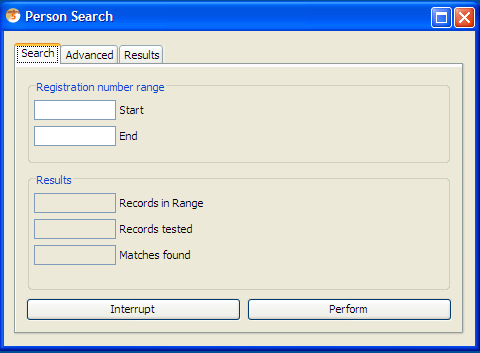

Registration number - range start and end.

##### Advanced

Change weights and search variables.

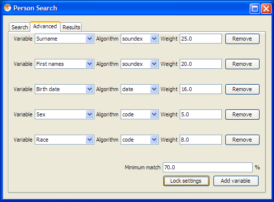

##### Results

Results from the search appears here as potential duplicates are found.

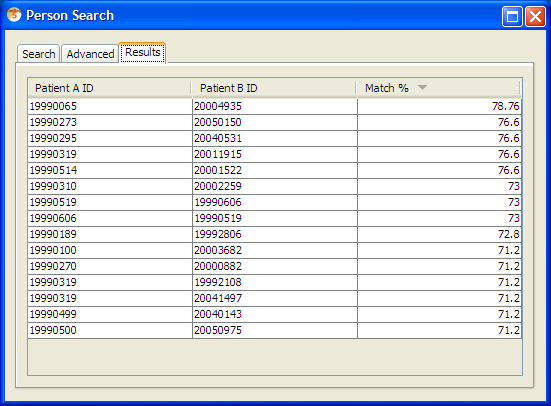

### Options

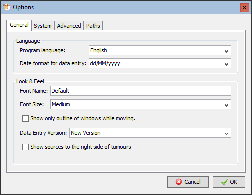

#### Language

Change the program language and date format (for data entry) of CanReg5.
(You need to restart your CanReg5 system if you change program
language.) The date format can be any format specified by a text string
using dd for days, MM for months, and yyyy for year, for example:
“yyyyMMdd” (the default), “dd/MM/yyyy”, or “MM.dd.yyyy”.

#### Look & Feel

You need to restart your CanReg5 system if you change font style or font
size.

##### Change font

Set the font size to sizes from Small to Big.

##### Change font style

You can set the font of CanReg by typing the name of the font you want
to use in the Font name text box. (To find out what fonts you have
installed on your Windows system you can take a look at the Fonts
section on your Windows Control Panel.) You can use this if the default
font doesn’t contain all the characters you would like to use or if you
just prefer the look of another font.

##### Show only outline

The “Show only outline of windows while moving” will increase the
performance of the user interface of CanReg. Tick this if moving windows
around the screen is slow.

##### \[NEW\] Data Entry Version

Here you can choose between the “New Version” of the data entry form and
the original version.

<figure id="fig:data-entry-new" data-latex-placement="h">

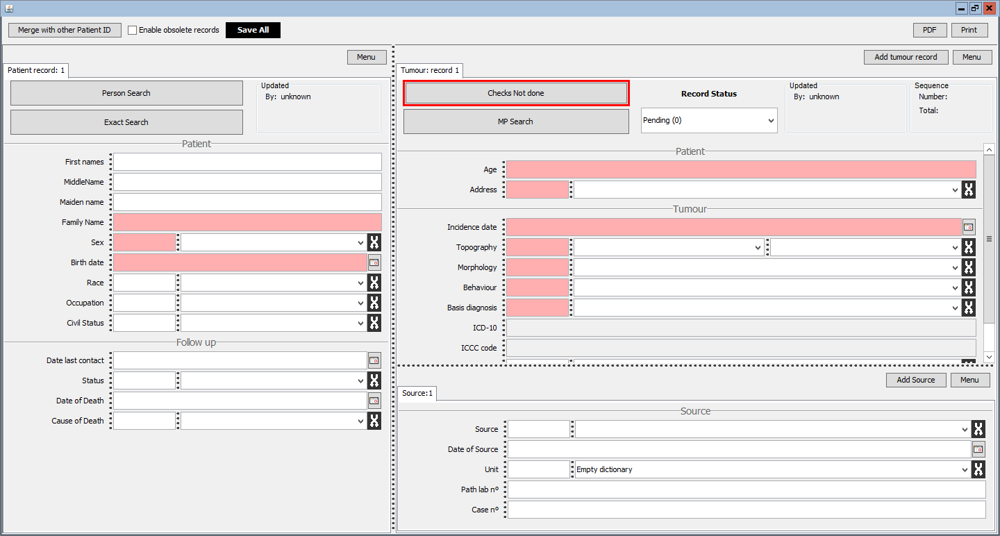

<figcaption>The new data entry
form</figcaption>
</figure>

<figure id="fig:data-entry-original" data-latex-placement="h">

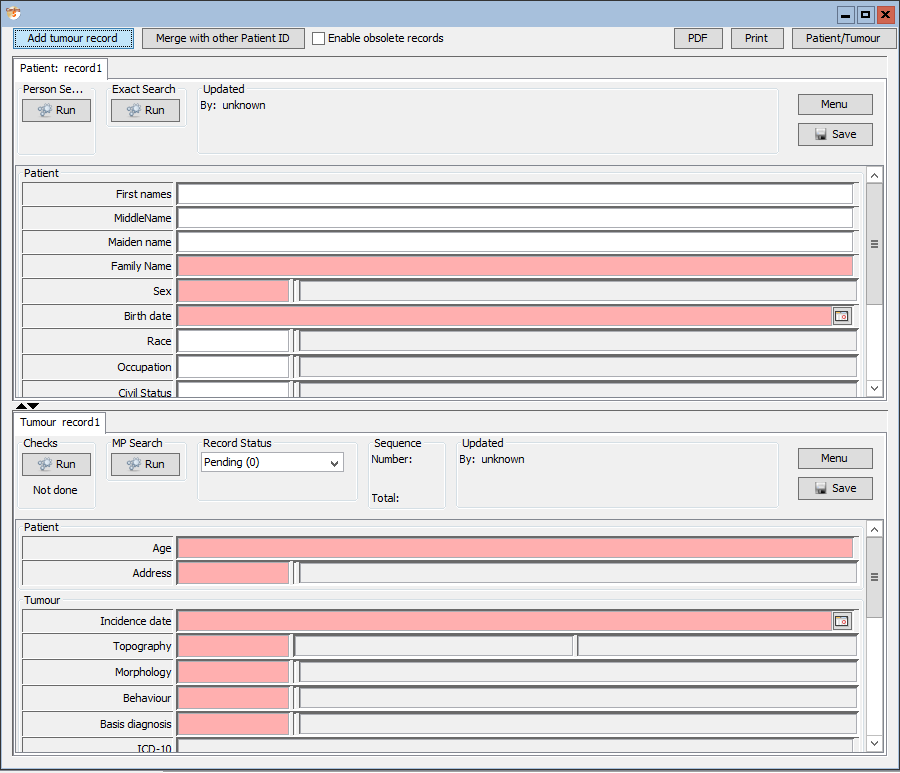

<figcaption>The original data entry
form</figcaption>
</figure>

##### \[NEW\]Show sources to the right side of tumours

This relates to the new version of the data entry form. Sources can
either be shown below or to the right of the tumours.

#### Periodic backup

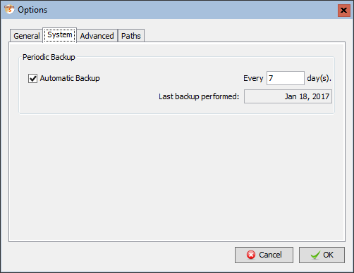

Reminder backup options

#### CanReg version

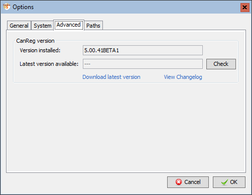

Let the program check to see if the latest version of CanReg is
installed. This will access the internet to find the most recent
version. You can click “Download latest version” to get the latest
universal version of CanReg (The zip-file.) or click “View Changelog” to
see what is new in CanReg.

#### Paths

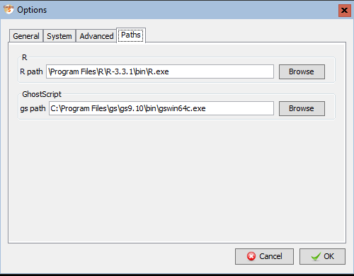

Here you can set the paths to the various helper applications of CanReg.
(So far only “R” and GhostScript.)

# Appendix

---

*[← Previous: 6. Analysis & Reports](06-analysis.md) | [Table of Contents](README.md) | [Next: 8. Frequently Asked Questions →](08-faq.md)*
