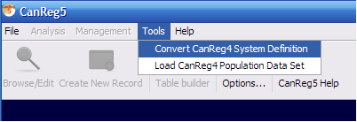
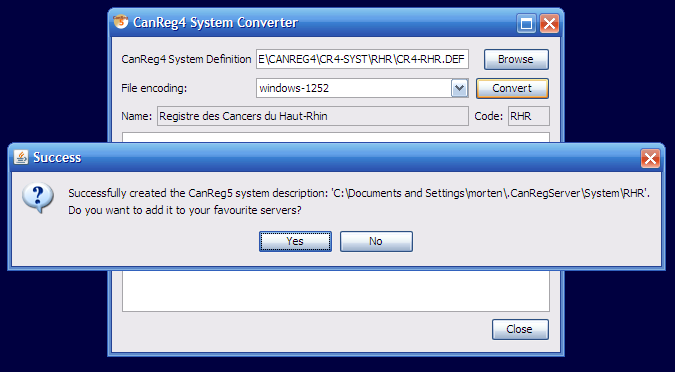
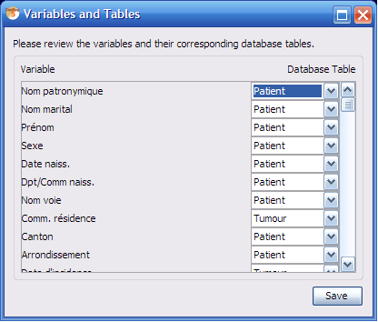
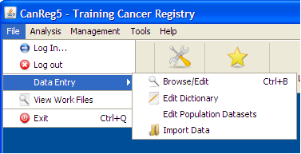

*[← Previous: 9. Known Issues](09-known-issues.md) · [Table of Contents](README.md) · [Next: 11. Advanced Database Management →](11-advanced-database-management.md)*

---

# 10. Migrating from CanReg4

(For a video demonstration of this process, please see webinar 3 -
available from the GICR website under “Resources”.
(<http://gicr.iarc.fr/en/resources.php#TRAINING>))

Install CanReg5.
(See<a href="#sec:Installing-and-running" data-reference-type="ref"
data-reference="sec:Installing-and-running">[sec:Installing-and-running]</a>)
Start CanReg5 and it presents you the Welcome window. Do NOT click
anything here just yet.

## Step 1 - Import the variable definitions of CanReg4 to CanReg5

The first step is to import the variables of CanReg4 to CanReg5 - the
system definition of CanReg4.)

1.  Go to “Tool” in CanReg5 menu and click “Convert system definition”.

    1.  

2.  Do “Browse” to find your CanReg4 system definition file. (This is a
    file located in the folder `\\CR4SHARE\CANREG4\CR4-SYST\` followed by
    your 3 letter registry code i.e. TRN whose name is ending in .DEF
    (i.e. CR4-TRN.DEF).)

3.  Select your CanReg4 file and double click it or click “Open”.

4.  Click “Convert”.

5.  The program will then ask you if you want to add this server to your
    favourites. Click “Yes” here.

    1.  

6.  The next step is the trickiest one during the conversion. Since we
    go from a tumour based database structure with only one big table
    with all the tumour and patient related information to a structure
    with both a table for tumour related information, one for patient
    related information and yet another one for source
    information<a href="#subsec:A-short-introduction" data-reference-type="eqref"
    data-reference="subsec:A-short-introduction">[subsec:A-short-introduction]</a>
    we need to specify what variable goes in what table of CanReg5. We
    recommend putting the unique patient related information (name, date
    of birth and follow-up variables) in the patient table, source
    information in the Source table and pretty much the rest (tumour
    information, age, address etc) in the tumour table.

7.  The program presents an initial proposal that you might agree with,
    but please go through one by one the variables and decide.

    1.  

8.  Click “Save”. You have now created an XML file that describes your
    CanReg5 system.

9.  Optional: Before you proceed to the next step and launch the server
    you can, if you want(!), edit this this XML file you have created.
    Either using the built in grapical tool in CanReg5
    <a href="#subsec:Setting-up-or-modifying" data-reference-type="eqref"
    data-reference="subsec:Setting-up-or-modifying">[subsec:Setting-up-or-modifying]</a>
    or manually by opening it in a text editor or a dedicated XML
    editor. The file is located in your user folder under .CanRegServer.
    (On my machine, for example, running Windows XP it is under:
    `C:\Documents and Settings\morten\.CanRegServer\System`.)

10. Click “Login”.

11. Launch the CanReg server

    1.  Click “Settings”

    2.  Click “Launch Server”. (If you get a java firewall query, please
        confirm that it is OK that java can comunicate through you
        firewall by clicking “OK” or “Yes”.) If this is the first time
        you launch the server on this machine it will automatically
        create the database needed for CanReg5.

12. Now it is time to log into the system.

    1.  Click “System”

    2.  Enter username: “morten”

    3.  Enter password: “ervik”

    4.  Click “Login”. The system will now log you onto your CanReg
        server.

## Step 2 - Import the dictionary from your CanReg4 installation

The thing we want to do now is to import the *dictionary* from your
CanReg4 installation or demo system. (Earlier we only imported the
description of what variables exist in you canreg4 database.) This is
demonstrated in the video called 06-import-dictionary.avi.

1.  If you are migrating from CanReg4 make sure to export the most
    updated dictionary from your CanReg4 system. (In CanReg4: “Data
    Entry”, “Dictionary”, “Export dictionary to text file”)

2.  Go to “File”, “Data Entry”, “Edit dictionary” in CanReg5

    1.  

3.  Click on “Import complete dictionary from file”.

4.  Browse and select the dictionary from you CanReg4 work folder or
    elsewhere.

5.  If CanReg does not detect the encoding of the file automatically,
    please select it from the drop down list.

6.  Click “Preview” to take a look at the dictionary. (Please note that
    only the first hundred lines or so are shown.)

7.  Tick “CanReg4 Format” if you are migrating, leave unticked if you
    are using the demo system or otherwise are importing a CanReg5
    formatted dictionary.

8.  Click “Import”. This might take some time. Please note the bar in
    the lower right indicating that the program is busy.

9.  Afterwards you will receive a message of success imported. Click OK.

10. Go back to “File”, “Data Entry”, “Edit dictionary” and verify that
    the dictionaries have been imported.

## Step 3 - Import the data from your CanReg4 installation

The next step is to import the *data* from CanReg4 to CanReg5. This is
demoed in the video called 07-import-data.avi.

1.  Make sure you export the most updated data from your CanReg4 system.

    1.  In CanReg4: “Analysis”, “Export data”

    2.  Tick “Export all variables”.

    3.  Choose variables names short

    4.  Under “Export File options” choose “Comma separated variables”

    5.  Untick “Format date”

    6.  Untick “Correct Unknown”

    7.  Click “write data to file” and pick a file name that you can
        find back easily in CanReg5. For example on the desktop. Click
        “save”.

    8.  Take a look at the data you have now exported and close CanReg4.

    9.  Take a note of the number of records. (This should later match
        the number of *Tumour records* in your CanReg5 system.)

2.  Back in CanReg5 do “File”, “Data Entry” and “Import Data”.

3.  Click “Browse” and locate the file from step A. Select it and click
    “Open”. You can if you want preview the file to see that you picked
    the right one and that the file looks OK. If for example Arabic
    names are garbled you should try to choose another “File encoding”
    (Default for Arabic text is ISO-8859-6).

4.  Set “Separating character” to Comma. (Or whatever separating
    character your file has.)

5.  Click Preview to see that the data looks OK.

6.  Click “Next” (or select the tab “Associate Variables”)

7.  This lets you associate the variables in the file to import with the
    variables in the database. CanReg5 will find most of these
    associations by itself, but you should revise them to see if they
    look OK. Look for variable names in bold, as they are the one that
    are not assigned at all.

8.  Click “Next” (or select the tab “Import File”)

9.  Click “Import” (leave everything as by default – the import function
    only works on empty CanReg databases as per now…)

10. Let CanReg5 import the data (this might take a while) and click
    “OK”.

11. Click “Browse/Edit” and “Refresh Table” to see that the data has
    arrived well. *Verify that you have the same number of tumours in
    the tumour table as in CanReg4.* Double click a record to take a
    look at it.

---

*[← Previous: 9. Known Issues](09-known-issues.md) | [Table of Contents](README.md) | [Next: 11. Advanced Database Management →](11-advanced-database-management.md)*
