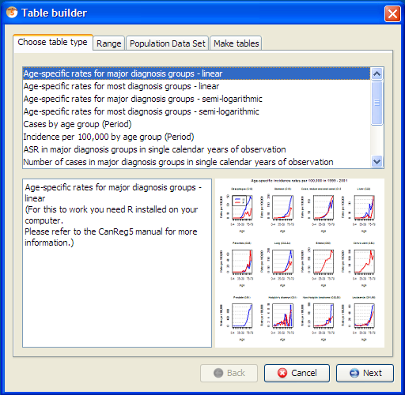
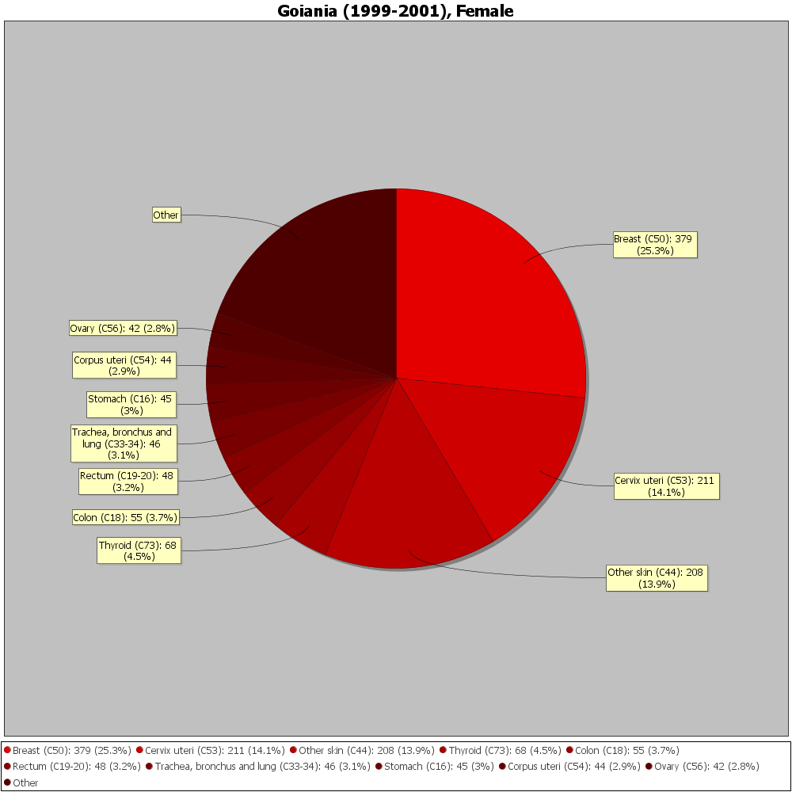

*[← Previous: 11. Advanced Database Management](11-advanced-database-management.md) · [Table of Contents](README.md) · [Next: 13. Third Party Tools →](13-third-party-tools.md)*

---

# 12. Technical Details on the Table Builder

The graphical tool to build tables in CanReg5, the Table Builder, can be
modified to suit particular needs of users via configuration files.
CanReg comes with some default ones, but these can be added to as the
user sees fit.

## Configuration files

The default configuration files of these tables can be found in the
“conf/tables” folder in your CanReg5 installation. The user provided
ones are found in the “conf/tables” folder in the “.CanRegClient”
folder. For each line in the Table Builder you will find a corresponding
.conf-file. (See figure
<a href="#fig:The-Table-Builder" data-reference-type="ref"
data-reference="fig:The-Table-Builder">1.1</a>)

<figure id="fig:The-Table-Builder">
<div class="centering">

</div>
<figcaption><span id="fig:The-Table-Builder"
data-label="fig:The-Table-Builder"></span>The Table Builder</figcaption>
</figure>

The user can change or add new configuration files and they will appear
in this list.

### The file structure and parameters

The easiest way to familiarize oneself with the structure of these
configuration files is to open one and take a look. The first thing we
notice is that you have several parameters and labels grouped by curly
brackets. The entry *“table_label”* for example contains one entry witch
is the label, or name, of the table. This is what will be displayed in
the list in the table builder. Let’s go through the standard groups one
by one:

#### table_label

The name or label of the table.

#### table_description

The description of the table - more information that the user will see
when he selects the table in the list.

#### table_engine

This is the name of the engine that will produce the table when the user
click *Generate* in CanReg5*.* More on this in the next sub section.

#### engine_parameters

These are parameters to the different engines, and can be anything the
engine understand. For example a code saying “noC44” to tell the engine
that this should be counts exluding skin cancer - if the engine supports
that parameter.

#### preview_image

This is the name of a file found in one of the previews folders (within
the “conf/tables” folders mentioned above) that will displayed in CanReg
when the user has selected this table. The user provided previews
override the system provided ones.

#### ICD_groups_labels

Many tables also need a list of ICD group labels to display. This is
just a list of labels with the 3 first characters detailing if this
should be displayed for male/female cases. For example the line:

<div class="lyxcode">

"11 Lip"

</div>

Means that the name of this site/group of sites is Lip and it should be
displayed for both male and female.

<div class="lyxcode">

"01 Ovary"

</div>

on the other hand means that this should only be displayed for female
cases.

#### ICD10_groups (or ICD_groups)

Each of the labels from ICD_groups_labels must have a corresponding
definition detailing the actual ICD10 codes that goes into this group.
This can be found in ICD10_groups. Line number 1 in ICD_groups_labels
corresponds to line 1 in ICD10_groups, line 2 to line 2 etc. These
groups are parsed and interpreted run-time by CanReg so you can define
your own groups by following the following rules:

1.  For a single site enter the ICD10 code for that site, i.e. “C09”.

2.  For a single subsite enter the ICD10 code for that site, i.e.
    “C000”.

3.  For a range enter it as \<site\>-\<site without the leading ’C’\>,
    i.e. "C30-31".

4.  For a series of sites enter them like \<site or range\>, \<site or
    range\> etc., i.e. "C47,C49" or "C82-85,C96"

5.  There are some special sites that can be defined by using their
    standard names. These can not be part of any range or series:

    1.  "MPD" - Myeloproliferative disorders

    2.  "MDS" - Myelodysplastic syndromes

    3.  "O&U" - Other and unspecified

    4.  "ALL" - All sites

    5.  "ALLbC44" - All sites but C44

## Engines

CanReg5 has an ever increasing number of built in engines to produce
tables. Their names:

- “incidencerates”

- “numberofcases”

- “populationpyramids”

- “top10piechart”

- “r-engine”

- "r-engine-grouped"

### Incidence Rates Table(“incidencerates”)

This is the engine that produces a A4 ready to print overview of number
of cases per 100.000 per site in the database. (See figure
<a href="#fig:Incidence-Rates-per" data-reference-type="ref"
data-reference="fig:Incidence-Rates-per">[fig:Incidence-Rates-per]</a>.)

#### line_breaks

One special parameter in the configuration file of this table is the
line_breaks. It is a list of pairs of numbers detailing where to put
grey boxes behind the numbers to make them easier to read. For example

<div class="lyxcode">

"8,9"

"17,-1"

"21,1"

</div>

This means that at line 8 we start a 9 line big box. Stopping at line
17. Picks up again on line 21 for just one line.

### Number of Cases (“number of cases”)

This is the engine that produces a A4 ready to print overview of number
of cases per site in the database.

#### line_breaks

This has the same special parameter line_breaks as the “incidencerates”
engine.

### Population Pyramids (“populationpyramids”)

This is the simplest configuration file so far as it looks like this:

<div class="lyxcode">

table_label { 

<div class="lyxcode">

"Population Pyramids" 

}

</div>

table_description { 

<div class="lyxcode">

"Population Pyramids" 

}

</div>

table_engine { 

<div class="lyxcode">

"populationpyramids" 

}

</div>

preview_image { 

<div class="lyxcode">

"populationpyramid.png" 

} 

</div>

</div>

### Top 10 pie chart (“top10piechart”)

<figure id="fig:Pie-Chart" data-latex-placement="h">

<figcaption><span id="fig:Pie-Chart"
data-label="fig:Pie-Chart"></span>Pie Chart</figcaption>
</figure>

Here you place your “candidate” groups in the ICD10_groups and
ICD_groups_labels in the .conf file and the engine produses a pie chart
of the 10 most common cancers in your registry for the period you have
provided in either PNGs or SVGs.
(See<a href="#fig:Pie-Chart" data-reference-type="ref"
data-reference="fig:Pie-Chart">1.2</a>)

If you pass “noC44” as one of the engine parameters you get tables
excluding skin cancer.

### The R engines (“r-engine” and “r-engine-grouped”)

You can call R programs directly from within the TableBuilder of
CanReg5. This is detailed in
<a href="#subsec:CanReg-and-R" data-reference-type="ref"
data-reference="subsec:CanReg-and-R">[subsec:CanReg-and-R]</a>.

## CanReg and R

### Configuration file parameters

Like with the other Table Builder engines of CanReg you can configure
the R engines as well using configuration files. Specific to the R
engines are the following parameters:

#### r_scripts

This can be one or many R scripts that gets called by CanReg to produce
tables. (See the listing on page for a skeleton script.)

#### file_types_generated

This details what filetypes this R script can generate. For example:

<div class="lyxcode">

file_types_generated {  

<div class="lyxcode">

"pdf" 

"ps" 

"svg"

"html"

}

</div>

</div>

```
Args <- commandArgs(TRUE)
## Find directory of script 
initial.options <- commandArgs(trailingOnly = FALSE) 
file.arg.name <- "--file=" 
script.name <- sub(file.arg.name, "", 
initial.options[grep(file.arg.name, initial.options)]) 
script.basename <- dirname(script.name) 

source(paste(sep="/", script.basename, "makeTable.r")) 
source(paste(sep="/", script.basename, "checkArgs.r")) 
source(paste(sep="/", script.basename, "makeFile.r"))

##OutFile out <- checkArgs(Args, "-out")
fileType <- checkArgs(Args, "-ft")

# Load dependencies 
source(paste(sep="/", script.basename, "myLibrary1.r"))
...
source(paste(sep="/", script.basename, "myLibraryN.r"))

# The incidence file  
fileInc <- checkArgs(Args, "-inc") 
dataInc <- read.table(fileInc, header=TRUE)

# The population file 
filePop <- checkArgs(Args, "-pop")
dataPop <- read.table(filePop, header=TRUE)

#do your plot
generatedFilenames = createMyNiceFigure(dataInc, dataPop) 
dev.off()

# write the name of any file created by R to out 
cat(generatedFilenames)
```

### Arguments

When calling the R scripts CanReg provides the following arguments:

- *-ft=\<filetype\>* The file type - either pdf, png, wmf, ps, html or
  svg.

  - This is how CanReg gives information to the R program on what
    file(s) should be created.

- *-out=\<filename\>* The base of the report file name - or output file
  name if you want.

  - The R program generates either a file with that name - with added
    standard file type suffix, or a series of file names with this as
    the base. One important point is that the way CanReg detects what
    files that actually has been created is by listening to the standard
    output of R. All the R program has to do is to write (print or cat)
    the files generated to standard out and CanReg will try to do system
    calls to display them when they are done.

- *-pop=\<filename\>* Population file name.

- *-inc=\<filename\>* Incidence file name.

Some scripts can also take additional arguments like:

- *-logr* Turn logaritmic plots on.

- *-onePage=axb* Generate summary page(s) with all the plots laid out in
  a columns and b rows.

Example call:

<div class="lyxcode">

"C:\Program Files\R\R-2.12.2\bin\R.exe" 

--slave --file=

"C:\Users\ervikm\Desktop\CanReg\\.\conf\tables\r\test.r"

--args -ft=svg -out="C:\Documents and Settings\ervikm\Desktop\test"

-pop="C:\Users\ervikm\Temp\pop4834689295162083243.tsv"

-inc="C:\Users\ervikm\Temp\inc4297000362541616146.tsv"

-onePage=3x4 

</div>

(The user never sees this, but it can be useful to keep this in mind
when writing your own R scripts.)

### Population file 

CanReg writes a population file to a temporary file with the following
columns:

1.  YEAR

2.  AGE_GROUP_LABEL

3.  AGE_GROUP

4.  SEX

5.  COUNT

### Incidence file

CanReg writes an incidence file to a temporary file with a structure
depending on the script and the engine.

#### r-engine

If you use the r-engine you can specify the columns you need from CanReg
with the variables_needed configuration file parameter. For example:

<div class="lyxcode">

variables_needed {  

<div class="lyxcode">

"Age" 

"ICD10" 

"Sex" 

}

</div>

</div>

This will create an incidence file with the following columns:

1.  YEAR (added automatically)

2.  AGE

3.  ICD10

4.  SEX

5.  CASES (added automatically)

#### r-engine-grouped

If you use the grouped version of the r-engine CanReg will group the
cancer cases according to the groups defined in the configuration file
and create an incidence file with the following columns:

1.  YEAR

2.  ICD10GROUP

3.  ICD10GROUPLABEL

4.  SEX

5.  AGEGROUP

6.  MORPHOLOGY

7.  BEHAVIOUR

8.  BASIS

9.  CASES

### SVG support

To be able to generate SVG files in the R programs you need to install a
package called “RSvgDevice” from within R. To install this package you
need to lauch R and type in the following command.

<div class="lyxcode">

install.packages("RSvgDevice")

</div>

Then select a country (mirror) close to you and click OK. This will
install the package and it is ready for R to use. You can now close R
and if all went well start producing SVG figures calling R functions
from CanReg.

(In the latest version of the R programs distributed with CanReg there’s
built in functionality to automatically install this package if you are
connected to the internet.)

---

*[← Previous: 11. Advanced Database Management](11-advanced-database-management.md) | [Table of Contents](README.md) | [Next: 13. Third Party Tools →](13-third-party-tools.md)*
